# 统一权限管理系统：结构化分析与模块分解

软件工程导论课程讲稿，修订版 2.0。24 页，建议约 30 分钟，含读图停顿。

配套演示：[需求分析演示](%5B软件工程%5D需求分析演示.pptx)。业务依据：[需求规格说明书 2.1](thinking/统一权限管理系统需求规格说明书.md)。

每节对应一页 PPT。引用段落为屏幕说明，正文为口述稿，已同步到演讲者备注。“依据”和末尾核对表供备课使用。信息流、业务步骤与模块控制关系分别标注。新增处理分解与结构图为教学推导，不虚构真实调研经历，不展开接口、数据库或类设计。

## 01 统一权限管理系统需求分析

> 结构化分析与模块分解
> 围绕需求规格说明书，解释分析依据、信息处理和责任划分。

今天我们介绍统一权限管理系统的需求分析。我们会沿着一个问题往下讲：拿到“集团希望统一管理权限”这样的描述后，怎样逐步明确系统要解决什么、与谁协作，以及可以拆成哪些责任。这里采用结构化分析的思路，结合业务场景和数据流图，把功能、规则与验收条件连接起来。最后得到的模块分解，是后续设计的输入。本次先讲清这些分析依据，不展开程序和存储细节。

依据：第 1.1、2.1 节。

## 02 业务问题、目标与规模

> 各系统分别登录、分散授权，集团难以掌握员工当前的有效权限。
> 统一身份、集中配置授权，在受控操作前取得当前判断。
> 10 公司、101 部门、10,000 员工、17 外部系统；OA 与知识库用于演示。

项目背景是一个虚拟集团，各业务系统由不同开发商建设，分别维护账号和权限。员工进入不同系统时需要分别登录，管理员也要进入不同后台授权。集团很难回答“某个人现在能访问哪些系统、能做哪些操作”。员工调动或离开后，遗漏撤权也可能发生。所以分析起点既包含登录体验，也包含权限的集中掌握和及时变化。后面的每一项需求，都应该能回到这些问题上解释它的必要性。

确认问题之后，我们界定建设目标：集中维护身份，通过角色管理权限，让独立系统在登录和业务操作时取得统一判断。初始化规模是一万名员工、十个公司、一百零一个部门和十七个外部系统。原始权限清单出现十八个系统名称，其中“系统管理后台”对应平台自身，所以不作为外部系统重复接入。规模用于约束分析和验收，演示只实现 OA 与知识库两个模拟系统的少量功能，不要求重建十七套完整业务。

依据：第 1.2、2.1、2.3.1、7.5 节；ACC-F-001。

## 03 需求澄清：把形容词变成规则

> 统一登录仍需按目标系统鉴权；实时明确为变更成功后最多 3 秒影响后续请求。
> 管理员区分全局与本部门范围；岗位名称不自动产生平台管理身份。
> 三份表格提供初始事实；54 名直属员工保留部门待确认状态，不自行猜测归属。

我们的事实来源包括课程背景、员工表、部门表和权限清单，以及已经确认的业务规则。资料提供了规模和名称，却不会自动给出完整需求。例如，岗位叫“系统管理员”，是否就有平台管理权？有些员工的部门填的是公司，应该如何处理？这些都需要澄清。当前基线保留五十四名公司直属员工的待确认部门状态，不随意归入某个部门。这里展示的是根据资料整理问题的方法，没有假设真实客户已经接受过访谈。

拿到需求时，“统一登录”“实时生效”“管理员可以授权”都还不够明确。我们要继续问：登录以后是否自动有权限？实时是立刻完成，还是允许短暂延迟？部门管理员能不能给其他部门的人授权？确认后的规则是，认证与授权分别判断，相关变更最多三秒影响后续请求，部门管理员只能管理本部门。这样，原来容易产生不同理解的话，就变成了可以检查的行为。其他需求也用同样的方法逐项澄清。

依据：第 1.3、1.4、2.3.1–2.3.3 节。

## 04 结构化分析的工作顺序

<!-- diagram: method -->

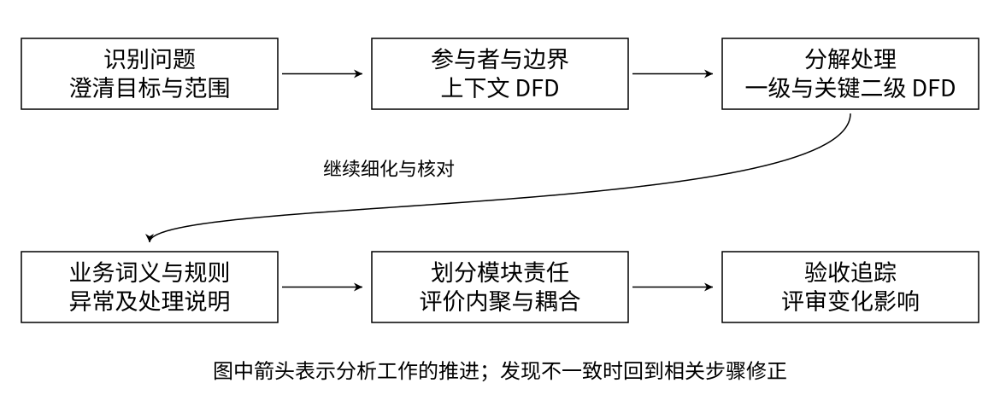

> 按问题逐层分解，再用场景和验收反查；发现矛盾时回到上一层修正。

这张图按分析工作的顺序读。先确认问题和范围，再识别参与者及输入输出，画上下文图；打开系统内部后，分解处理、整理业务信息；关键处理继续细化，补充规则与异常，最后形成模块责任和验收条件。

每次分解都要问，这层解决什么、使用哪些事实、输出是否回应上层需求。如果角色停用以后究竟保留还是撤销分配仍说不清，就应回到业务规则确认。结构化分析提供逻辑信息模型，模块分解开始讨论责任组织。两步相互校验，但一个处理不必直接对应一个模块，也不代表已经确定程序调用。

依据：第 3、4、7.4、7.5 节；工作顺序为教学整理。

## 05 参与者与系统边界

> 员工使用统一认证入口；最高管理员管理全局；部门管理员维护本部门员工、角色与授权。
> 平台判断身份和权限；外部系统保存业务记录、执行操作，检查“本人”等业务数据范围。
> 本期不处理 OA 审批、不推送外部账号。用户名加手机号属于课程简化校验。

识别参与者时，我们看谁在与平台交换信息，以及他想完成什么。普通员工访问业务系统，不进入后台；最高管理员维护全局基础，部门管理员只维护本部门；外部系统验证身份结果、请求鉴权并上报目录。同一个人具有管理员身份时，业务访问与后台管理仍要分别判断。

可以用“导出本人报表”说明边界。平台判断有没有导出权限，外部系统判断哪些报表属于本人，并执行导出。平台不接管业务数据，也不代理转发全部请求。审批和线下申请在外部完成。登录校验虽然采用课程简化，隔离与拒绝越权仍需验收。这样能限制范围，又不遗漏双方协作的必要责任。

依据：第 2.2、2.3.3、2.3.4、4.1、6.1 节。

## 06 业务模型与核心约束

<!-- diagram: rules -->

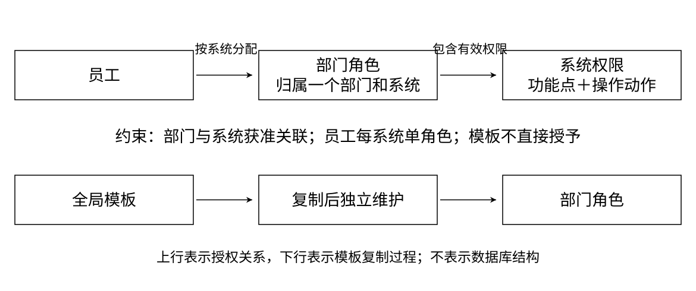

> 员工通过部门角色获得系统权限。每员工每系统最多一个角色，跨系统分别配置。
> 模板复制后独立维护；部门可用系统不直接授权；平台管理身份不等于外部业务角色。

图中先看员工、角色与权限。我们采用 RBAC0，由角色组合功能点和操作动作，员工通过角色取得权限，不引入个人直接权限或角色继承。每员工每系统最多一个角色，是项目另外确认的业务限制，不能说成 RBAC0 必然要求。

角色同时属于一个部门和一个系统，只选择对应系统的有效权限。部门与系统是多对多可用关系，但开放系统不直接授权员工。五类模板只提供复制起点，不能直接分配；模板更新不覆盖已有部门角色。最高管理员身份也不会自动获得 OA 业务权限。图表达业务关系，不表示数据库结构；这些词义统一以后，后续分解才有一致基础。

依据：第 1.3、2.3.2、3.1、4.2.11、4.2.12 节。

## 07 上下文 DFD：确定平台边界

<!-- diagram: context -->

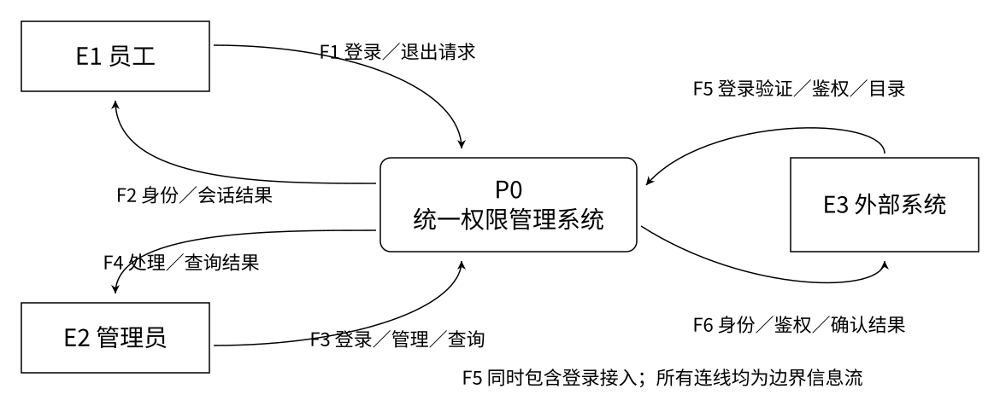

> P0 表示整个平台，F1–F6 覆盖外部输入输出。箭头表示信息流，业务记录留在外部。

明确参与者和边界后，我们把整个平台先当成一个处理，画上下文数据流图。员工提交登录和退出请求，取得身份及会话结果；管理员提交管理与查询，取得处理结果；外部系统提交登录验证、鉴权和目录信息，取得相应结论。先看输入，再看输出，就能检查每个参与者的目标有没有得到回应。这里暂时不展开平台内部，也不表示各请求的先后顺序。外部业务数据没有经过平台，这同样是边界判断的一部分。

依据：第 3.2 节，F1–F6；按图 3-2 重绘。

## 08 一级 DFD：外部请求如何分流

<!-- diagram: level1-boundary -->

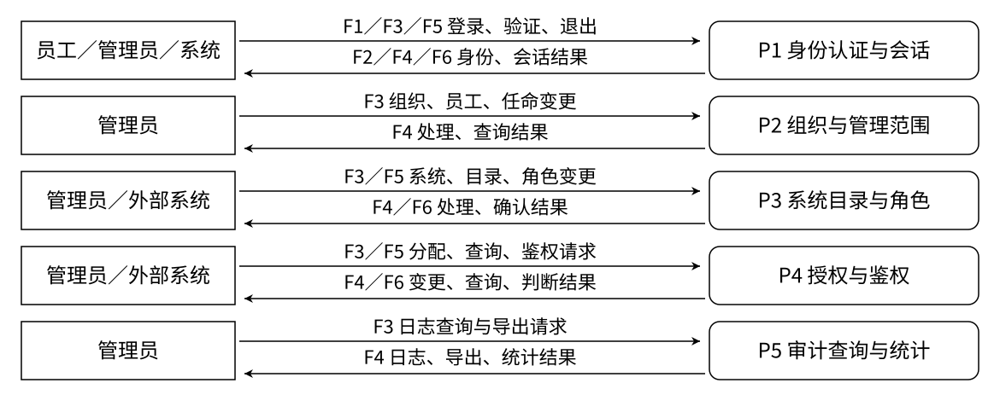

> 展开 P0 得到 P1–P5。本页保留全部边界交换；下一页展开相同处理使用的信息集合。

打开平台后，按信息处理责任识别五个处理。P1 管身份认证与会话，P2 管组织与管理范围，P3 管系统目录与角色，P4 管授权与鉴权，P5 管审计查询与统计。管理员请求按目的进入不同处理；员工的登录退出进入 P1，外部系统请求进入 P1、P3 和 P4。

这页是一级图的边界交换视图，只隐藏内部信息集合，下一页继续看相同处理的事实读写。这样避免所有连线挤在一起。每一类输入都要有对应结果，例如目录上报必须得到确认或拒绝，不能只画输入。分流依据是信息处理目的，不能按后台菜单数量直接认定处理数量。

依据：第 3.3 节；与第 09 页共同表达一级数据流。

## 09 一级 DFD：处理依赖哪些事实

<!-- diagram: level1-facts -->

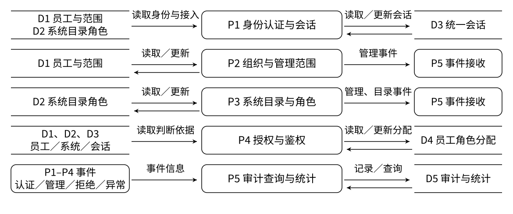

> D1 员工与范围，D2 系统目录角色，D3 会话，D4 分配，D5 审计统计；信息集合之间不直接传递。

接着看五个处理使用的信息。P2 维护员工与管理范围，P3 维护系统、目录和角色，P1 读取这两类事实并改变统一会话。P4 既要读员工、系统、会话，也要读取和改变角色分配。P1 至 P4 产生的认证、管理、拒绝和异常事件汇入 P5，形成可查询记录。

D 编号表示业务信息集合，不规定保存方式。图中重复出现的 D1、D2 表示同一信息。读箭头时区分读取与更新：运行时鉴权读取分配，不会因为判断成功而新增角色。信息集合之间不能直接互传，每项输出都要有来源。配合上一页，这样才能同时检查外部承诺和内部处理依据。

依据：第 3.3 节，D1–D5；与第 08 页共同表达一级数据流。

## 10 二级 DFD：展开授权与鉴权 P4

<!-- diagram: level2 -->

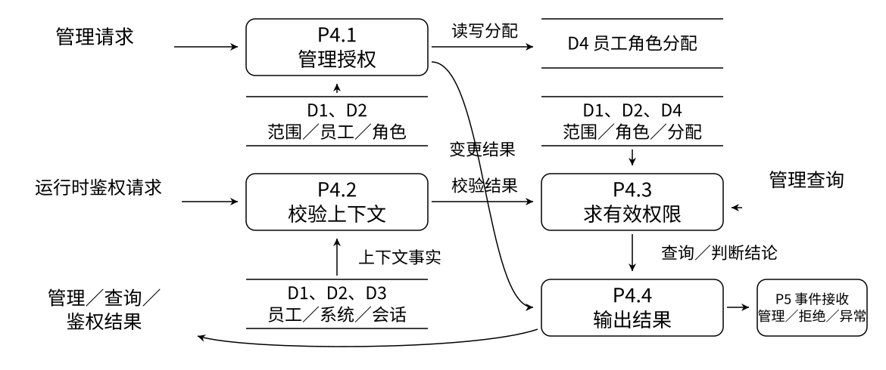

> 保留管理、查询、运行时鉴权三类输入；变更结果、有效权限和判断结论分别返回。

P4 仍然比较大，所以继续展开。P4.1 处理管理授权，校验范围、员工和角色事实后改变分配；P4.2 校验运行时系统身份、员工和会话；P4.3 根据校验结果和范围、分配、角色及目录求有效权限；P4.4 输出结果，并交付管理、拒绝和异常事件。

沿运行时输入读，是上下文校验后得到权限结论；沿管理输入读，是改变分配后返回结果。管理员查询也进入有效权限处理，但只要求操作者有会话和管理范围，不要求目标员工登录。这里同时保留几种输入，避免只画鉴权就漏掉父处理原来的管理与查询。箭头表示信息流，判断顺序再用流程说明。

依据：第 3.4 节，P4.1–P4.4；按图 3-4 重绘。

## 11 层间平衡与业务数据字典

> 管理请求在 P4.1 处理、P4.4 返回；鉴权经 P4.2、P4.3 形成结果；查询进入 P4.3。
> 角色分配表达员工在某系统取得的角色；鉴权结论区分允许、拒绝和无法确认。
> 检查无来源输出、遗漏结果与新增外部需求。DFD 表达信息加工，流程图补充顺序和分支。

分解完成后，要从子图返回父图检查。比如 P4 对外接收管理变更、查询和鉴权请求，子图必须都能找到对应处理和结果；不能只展开鉴权，就让管理授权消失。上下文中外部系统的登录、目录和鉴权信息，也分别要落到一级处理。检查时还要避免只有输入没有结果、没有依据却生成结论，以及信息集合之间直接传递数据。如果发现缺漏，应该回到需求或分解图修正，再继续细化。

数据流图适合解释判断依据从哪里来，但它不会完整表达登录跳转的时间顺序，也不适合用来展示失败后如何重试。因此，我们再用业务流程图说明参与者的动作、条件和先后关系。例如目录上报，数据流图说明旧目录如何参与处理，流程图说明确认响应丢失以后重新上报。两种图描述同一件事的不同方面，需要相互核对。接下来我们沿具体场景，把正常过程、业务规则和失败结果一起补齐。

依据：第 1.3、3.2–3.4、6.1、7.5 节。

## 12 登录、会话复用与统一退出

<!-- diagram: login -->

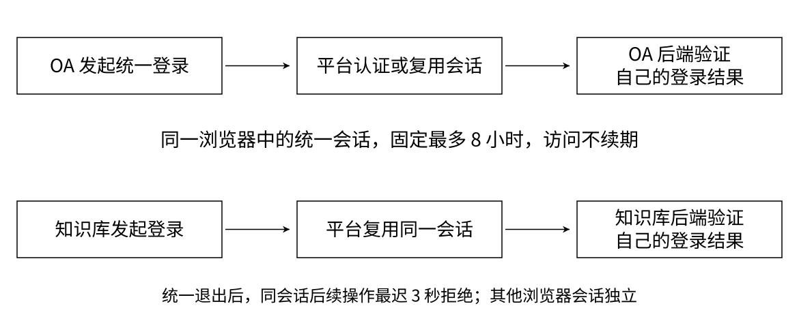

> 同一浏览器复用身份会话；每个系统分别验证自己的结果和业务权限。统一退出只影响当前统一会话。

员工先在 OA 选择统一登录，再到平台提交用户名和手机号，平台确认身份后返回登录结果，由 OA 后端验证。这里的前置条件包括系统已登记、返回目标获认可、员工有效。进入知识库时，可以复用同一浏览器里的有效统一会话，但要为知识库产生自己的登录结果，不能拿 OA 的结果直接使用。过期、篡改、重复使用或跨系统使用都应该拒绝。结果是系统识别了员工，具体操作权限仍由后续鉴权判断。

会话要说明生命周期。统一会话最多有效八小时，持续访问不会推迟绝对到期时间。在任一入口统一退出后，同一会话关联的其他系统，最多三秒拒绝后续受控操作；另一个浏览器的独立会话保持不变。员工停用则影响该员工的全部会话。如果平台故障，外部系统可以清理自己的关联，但必须说明统一退出尚未确认，不能宣称已经全局成功。页面不要求自动关闭，不过已经显示的页面也不能继续成为执行操作的依据。

管理员进入后台还要校验有效管理身份，普通员工即使认证成功也不能进入；管理身份取消后，后续后台访问应按新状态判断。

依据：第 4.2.1–4.2.4、4.3.1、4.3.3 节；AUTH-001–004。

## 13 组织维护与管理范围

> 公司、部门两层结构，用户名与手机号分别唯一；部门未明确时不先行授予部门角色。
> 管理身份单独任命，至少保留一名有效最高管理员；部门管理员范围取自实际所属部门。
> 列表、详情、修改、批量和导出都校验范围。组织停用先处理关联，部门变化必须走调动流程。

基础数据维护也要分析限制。公司和部门采用两层结构，部门名称结合所属公司识别，不能看到同名就合并。员工用户名和手机号分别唯一，五十四名部门待确认员工可以认证，但不能先分配部门角色。管理员必须明确任命，岗位名称不自动产生管理身份；同时需要保留至少一名有效最高管理员。组织停用前要处理有效关联。已经归属部门的员工改变部门，需要走调动流程，即使他目前没有角色，也不能绕过相关检查。

取消本人最高管理员身份须由另一名最高管理员操作，不能把组织资料维护理解为几个没有约束的增删改查。不同公司同名部门不合并，用户名和手机号也不能重复。规则需要同时覆盖正常维护、停用和管理权变更。

依据：第 4.2.5–4.2.8、7.2 节；ORG-001、EMP-001、EMP-002、ADM-001。

## 14 系统接入与权限目录更新

<!-- diagram: directory -->

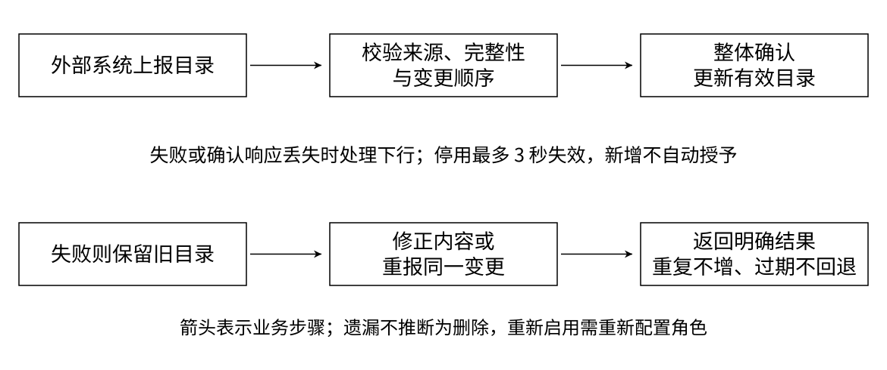

> 系统登记及部门范围由最高管理员维护；目录由外部系统上报，整体确认或拒绝。

系统接入的目标是让平台识别参与协作的业务系统，并明确哪些部门可以使用它。最高管理员登记系统身份、认可返回目标，再配置部门可用范围。移除某个部门或停用整个系统之前，需要显示受影响角色和员工，并由管理员确认。变更成功后最多三秒影响后续接入和鉴权。原有配置可以保留用于查询，但不能在范围无效时继续产生有效权限；重新启用时也要提示可能恢复访问，避免管理员误判影响。

目录内容由外部系统定义。平台先确认上报来源和目标一致，再检查权限标识、完整性和变更顺序，整体接受或整体拒绝。失败时保留上一次已确认目录；如果确认响应丢失，外部系统重报同一变更，不能重复建立权限或回退目录。停用必须明确表达，遗漏项不直接视为删除。新增权限不自动授予，停用项最多三秒失效，重新启用后还要重新配置角色。分析这些分支，是为了避免一次通信异常就扩大或恢复权限。

依据：第 4.2.9、4.2.10、4.3.4 节；SYS-001、PERM-001。

## 15 模板与部门角色的配置规则

> 五类初始岗位权限作为系统模板，供部门复制；模板不能直接分配员工。
> 部门角色只选本系统有效权限，复制后独立维护；新增权限不会自动进入已有角色。
> 修改、停用前说明影响人数；有分配不能直接删除，空权限角色不能通过受控操作。

角色配置分成模板和部门角色两个场景。最高管理员维护属于某系统的模板，部门管理员在获准系统内复制模板或自建角色，并只选择这个系统的有效权限。复制后两者独立，避免一次模板调整悄悄改变多个部门。角色变更要展示影响人数，停用角色会让现有分配失去有效权限；仍有分配时不能直接删除。空权限角色可以留待配置，但不能通过受控操作。这样每种状态都有明确业务含义。

这一组规则同时涉及归属、状态和变更后果。部门 A 修改自己的角色，不影响部门 B；权限重新启用，也要重新配置角色才恢复授予。分析清楚这些变化后，分配与鉴权才有明确的有效角色事实可用。

依据：第 4.2.11、4.2.12 节；ROLE-001、ROLE-002。

## 16 换角、批量处理与撤权

<!-- diagram: assignment -->

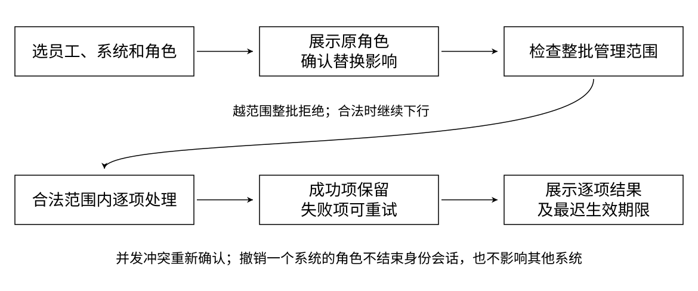

> 先确认影响，再检查整批范围。受理、保存成功与权限生效分别展示；逐项成功分别计算生效窗口。

分配角色前，需要展示员工当前角色和目标角色。如果已经有旧角色，就明确提示替换，因为每员工每系统只能有一个未撤销分配。批量处理要分清两个层次：只要混入其他部门员工，就整批拒绝；如果整批范围合法，但个别人状态已经变化，可以逐项失败并保留成功项。界面必须显示逐人结果，不能用“已受理”表示全部成功。两人同时换角发生冲突时，要提示重新确认，不能悄悄用最后一次操作覆盖。

撤权场景需要明确范围。撤销 OA 角色，不应影响知识库角色，也不会直接结束员工的身份会话。没有角色时重复撤权，可以返回已无授权。批量操作中成功项保留，失败项可以重新提交。这里还要区分保存成功和生效时间：每个成功项从变更提交完成起，最多三秒影响后续鉴权，整批受理不等于整批已经生效。界面需要给出结果和最迟生效期限，防止管理员以为点击按钮的一刻就完成了全部影响。

依据：第 4.2.13、4.2.14、5.2.1 节；GRANT-001、GRANT-002。

## 17 鉴权规则的处理说明

<!-- diagram: decision -->

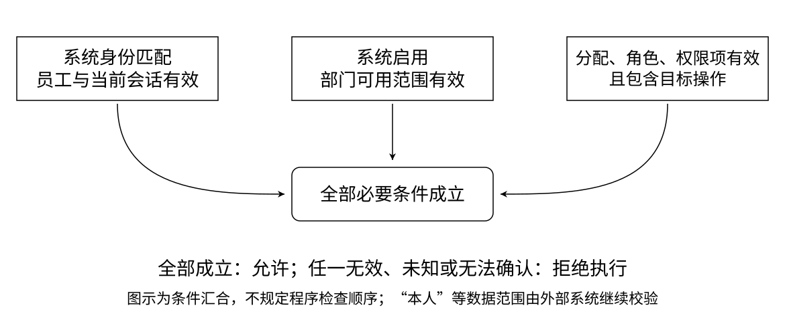

> 必要条件同时成立才允许；未知、无效或无法确认时拒绝。条件组合表示业务规则，不规定程序检查顺序。

看这张判断图，外部系统准备执行操作时，平台先确认系统身份与目标一致，再检查员工和当前会话，随后检查系统状态、部门范围、角色分配、角色与权限项。所有必要条件成立，当前角色又包含这个操作，才返回允许。无法可靠判断时，外部系统也不能执行。允许之后仍由外部系统检查“本人”等业务数据范围。这里分析的是决策规则，鉴权本身不修改角色，也不要求平台回滚已经开始执行的外部业务操作。

管理员查询使用相同的有效权限含义，但不要求目标员工已经登录。前端隐藏按钮也不能代替后端操作判断；查询要能解释无角色、范围失效等原因，帮助管理员区分配置与当前结果。

依据：第 3.4、4.2.15、4.2.16、6.1、6.2 节；AUTHZ-001、QUERY-001。

## 18 员工停用与跨部门调动

<!-- diagram: transfer -->

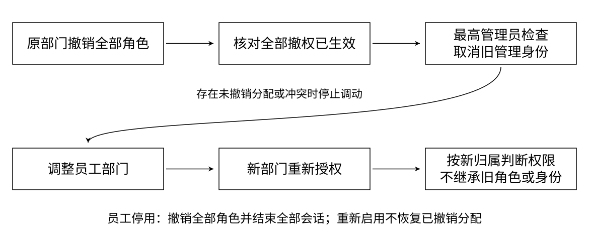

> 停用影响全部角色分配与全部会话；调动先撤权、核对生效，再变更归属并重新授权。

员工停用和调动都跨越多个业务责任。停用需要撤销全部系统角色，并让所有会话失效，重新启用也不自动恢复旧分配。调动则采用人工协作：原部门先撤完全部角色并核对生效，最高管理员取消旧部门管理员身份、修改部门，最后新部门重新授权。新部门不继承旧角色或管理身份。如果调动同时又发生授权，要识别冲突并要求重新处理。用这个场景检查，可以发现单看员工资料修改时容易遗漏的权限问题。

即使没有业务角色，调动也必须经过相同检查，不能直接改员工部门。最高管理员可以代办原部门撤权。用这类跨责任场景检查模块，能发现只看资料维护时遗漏的会话和分配约束。

依据：第 4.2.6、4.2.7、4.3.5 节；EMP-001、EMP-002。

## 19 查询、审计与故障语义

> 查询区分保存配置、有效权限和失效原因；审计按时间、对象、当时范围与结果追踪，导出也受范围约束。
> 审计失败不提交管理变更，不确认新登录，暂停新受控操作；已退出会话不恢复。
> 故障缺口明确报告，不承诺完整补录。正常允许鉴权只统计，拒绝与异常留痕。

管理员查询时，需要看到员工在各系统的角色，以及失效原因。例如角色还在，但系统已经停用，就应显示配置存在、当前无效。审计则回答是谁、何时、对什么范围做了什么，以及结果如何。部门管理员只能查看本部门相关事件，无法归属的系统异常只对最高管理员开放。认证、退出、管理变更、目录处理和鉴权拒绝都要可追溯；允许鉴权只计入统计。敏感登录资料不能进入记录或导出，历史归属也不能简单替换成员工现在的部门。

功能之外，还要分析失败时的行为。技术失败率预算不能容忍错误允许；部门隔离覆盖列表、详情、批量和导出。鉴权超时或平台不可用，外部系统拒绝操作并提示重试。审计存储失败时，管理变更不提交，新登录不确认成功，新的受控操作暂停；已经结束的会话不能因此恢复。故障期间要明确报告审计缺口，不承诺完整补录。可用性还包括清楚的影响确认和可执行提示，让用户知道结果以及下一步可以怎么做。

依据：第 4.2.16、4.2.17、6.2、7.1–7.3 节；QUERY-001、AUDIT-001。

## 20 DFD 处理怎样映射为六个模块

<!-- diagram: mapping -->

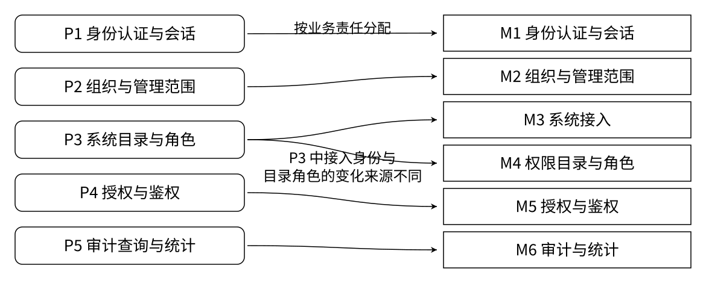

> P3 进一步拆为系统接入、权限目录与角色。根据责任和变化来源划分，模块不等于页面或部署单元。

现在从逻辑信息处理过渡到模块责任。P1 对应身份认证与会话，P2 对应组织与管理范围，P4 对应授权与鉴权，P5 对应审计与统计。P3 包含两组不同变化，所以进一步拆成系统接入，以及权限目录与角色。调整登录返回位置一般不需要改角色内容，新增权限也不要求改变系统身份。

目录与角色放在一起，因为角色只能选择有效目录，目录停用又直接影响角色内容。员工取得哪个角色归授权模块。规则关联紧密的部分集中，变化来源不同的部分分开，得到六个模块。代价是要明确协作，不能各自判断互不一致。图里箭头表示责任映射，不是运行调用。

依据：第 3.3、3.4、4.2 节；六模块为既有项目责任划分的教学说明。

## 21 变换分析与事务分析的适用位置

<!-- diagram: transform -->

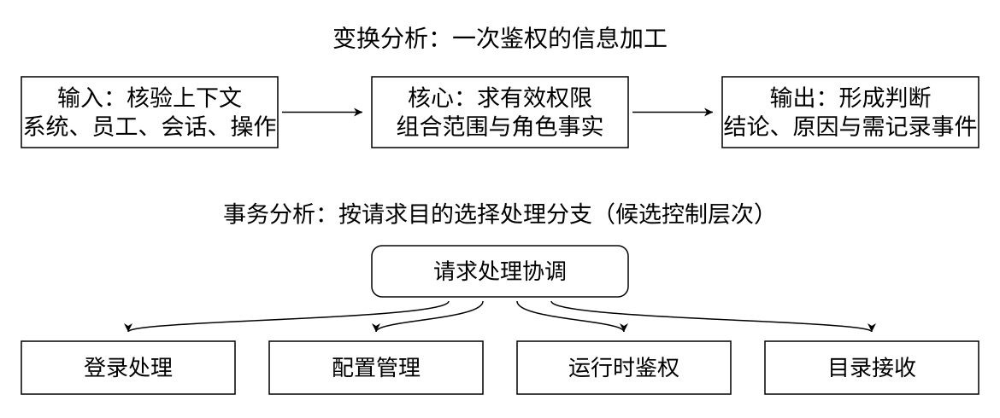

> 变换分析识别输入、核心加工与输出；事务分析按请求目的选择分支。两种方法辅助推导，仍需业务规则校验。

结构化设计可以继续问：信息加工怎样组织成责任层次。鉴权适合用变换分析。把系统、员工、会话与操作整理成可信上下文，是输入侧；结合有效事实求权限，是核心变换；把结论、原因和需要记录的事件整理成结果，是输出侧。由此识别各部分责任，但仍受范围、状态及失败规则约束。

平台接收登录、配置管理、鉴权和目录上报，可以用事务分析识别按请求目的选择的处理分支，再分别细化。这里事务指请求类别和处理路径，不讨论数据库事务。图的上半部分是变换示意，下半部分是候选控制层次，不能把 DFD 箭头直接改名成调用。方法帮助分解，不要求每个业务硬套相同形状。

依据：依据需求第 3、4 章作教学推导；不新增业务需求，不确定程序调用。

## 22 模块质量与停止分解的依据

> 内聚：会话生命周期集中，目录和角色有效性集中；耦合：通过必要业务事实协作，避免重复维护他人规则。
> 新增权限主要影响目录角色，修改会话期限主要影响身份；多角色需求牵动分配、查询与鉴权。
> 当责任、输入输出、规则和异常可以说明并验收时，停止本次分解，不继续展开实现细节。

六个模块还要评价质量。内聚看职责是否围绕共同规则，例如登录、复用、到期与退出共同影响会话状态；耦合看它需要了解多少别人的细节。授权需要员工归属事实，但不应再发明一套部门维护规则。信息隐藏要求各模块负责自己的信息和规则，向协作者提供必要事实或结论。

拿变化检验会更具体：新增权限主要涉及目录角色，修改会话期限主要涉及身份；改成多角色时，分配、查询和权限合并都要重新分析。影响不一定能消除，但应该能定位。当前分析到责任、业务输入输出与异常都能说明就停止，再拆类和技术层次会超出本次范围。

依据：第 5.3、7.5 节；模块质量评价为教学推导。

## 23 非功能需求与可测量目标

> 登录：10,000 账号在 60 秒发起，完整流程 P95 ≤ 3 秒。鉴权：1,000 次/秒持续 5 分钟，P95 ≤ 300 毫秒。
> 100 管理员并发，常用操作 P95 ≤ 3 秒；混合负载分别达标。登录和鉴权技术失败率 ≤ 1%。
> 变更最迟 3 秒影响后续请求，越权零容忍。记录硬件、负载和测量边界，目标必须实测。

性能分析要把“支持一万人”补成负载、时间和测量边界。一万账号在六十秒内发起完整登录，统计从登录跳转到业务系统验证完成；持续鉴权每秒一千次，运行五分钟。两者技术失败率都不超过百分之一。管理员并发也持续五分钟，常用操作 P95 不超过三秒，还要与持续鉴权一起测试。最后单独检查变更三秒生效，不能把响应快当作权限正确。这些都是验收目标，需要记录环境并实测，当前讲述不将目标当作已达结果。

批量成功项分别计时，旧允许结果不能反复访问续期。技术失败率预算不容忍错误允许，不能用平均耗时代替 P95。测试还要报告硬件、实际完成量、失败和超时；浏览器支持主流桌面 Chrome 与 Edge，课程范围不要求移动端和生产级多活容灾。

依据：第 2.2、2.3.4、5、6.2、7.1、7.2 节；ACC-P-001–005。

## 24 验收追踪与需求变更评审

<!-- diagram: trace -->

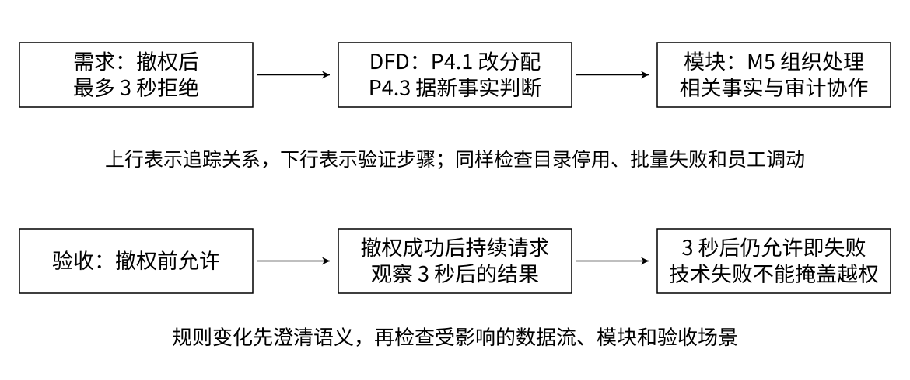

> 用“撤权后三秒拒绝”反查需求、DFD、模块责任和验收；再用目录停用、批量失败及员工调动检查遗漏。

用一个具体规则把分析串起来：撤权后三秒拒绝来自撤权用例和生效上限；P4.1 改变分配，P4.3 根据新事实形成结论；授权与鉴权负责这两组责任，相关事实和审计由对应模块协作；验收观察变更后三秒以后的请求是否仍有错误允许。

再用目录停用、批量失败、员工调动做同样检查，发现遗漏、矛盾与不明确表述。如果提出一个系统多个角色，先澄清合并和撤销语义，再检查数据流、职责和验收影响。结构化模型让讨论有共同依据，也保留了可修改的边界。备课表保留全部功能及性能验收位置，课程检查时可以沿一条规则继续追问。

依据：第 4.2.14、5.2、7.4、7.5 节；ACC-F-014、ACC-P-005。

## 备课与覆盖核对（不计入幻灯片）

第 07 页为上下文图，第 08、09 页是同一一级 DFD 的边界交换与信息集合视图，第 10 页为 P4 二级图，沿用需求文档的层级命名。第 21 页属于结构化设计的教学推导，图中控制关系与 DFD 信息流分别解释。建议给多级 DFD 和模块映射预留读图时间，正式展示前按个人语速试讲。

下表省略用例编号的 `UPMS-REQ-` 前缀。

| 用例 | 页码 | 验收依据 |
| --- | --- | --- |
| AUTH-001 管理员登录 | 05、12、13 | ACC-F-002、007 |
| AUTH-002 员工登录 | 05、07、12 | ACC-F-002–004 |
| AUTH-003 会话复用 | 12 | ACC-F-003、005 |
| AUTH-004 统一退出 | 12、18、19 | ACC-F-005、006 |
| ORG-001 组织维护 | 02、03、13 | ACC-F-001 |
| EMP-001 员工维护 | 03、13、18 | ACC-F-001、006、014、018 |
| EMP-002 调动 | 13、18 | ACC-F-015 |
| ADM-001 管理员任命 | 05、13 | ACC-F-007、018 |
| SYS-001 系统与范围 | 05、14 | ACC-F-001、008 |
| PERM-001 目录与重报 | 14、17 | ACC-F-013 |
| ROLE-001 模板 | 06、15 | ACC-F-009 |
| ROLE-002 部门角色 | 06、15、17 | ACC-F-009、012 |
| GRANT-001 分配替换 | 10、16 | ACC-F-010、011 |
| GRANT-002 撤权 | 16、18、24 | ACC-F-011、014、015 |
| AUTHZ-001 鉴权 | 07–11、17 | ACC-F-008、012、013、016、018 |
| QUERY-001 查询 | 10、17、19 | ACC-F-012、014 |
| AUDIT-001 审计 | 09、19 | ACC-F-017 |
| 五项性能验收 | 16、23、24 | ACC-P-001–005 |

数据字典补充：D1 是员工状态、组织归属与管理范围；D2 是系统身份状态、部门可用关系、目录和角色内容；D3 是统一会话与绝对有效期；D4 是员工在各系统的角色分配及撤销状态；D5 是历史事件与运行统计。“有效权限”需要综合状态和归属，“无法确认”要求外部系统拒绝执行。这里均为业务语义，不规定传输字段或存储结构。

层间平衡：F1/F2 在 P1 展开；F3/F4 按目的进入 P1–P5；F5/F6 的登录接入验证进入 P1，目录进入 P3，鉴权进入 P4。P4.1 接收管理请求并向 P4.4 提供结果；P4.2 接收运行时请求、向 P4.3 提供校验结果；管理查询进入 P4.3，其查询或鉴权结论交 P4.4。P4.4 返回相应结果，并向 P5 提供需记录事件。重复参与者、信息集合表示相同对象。

模块映射：P1、P2、P4、P5 分别承接 M1、M2、M5、M6；P3 的系统身份与可用边界形成 M3，目录及角色形成 M4。变换分析用于定位鉴权输入、核心加工和输出，事务分析用于区分请求类别。候选控制层次不确定类、网络端点、存储或部署，不将逻辑信息流直接等同于调用。
