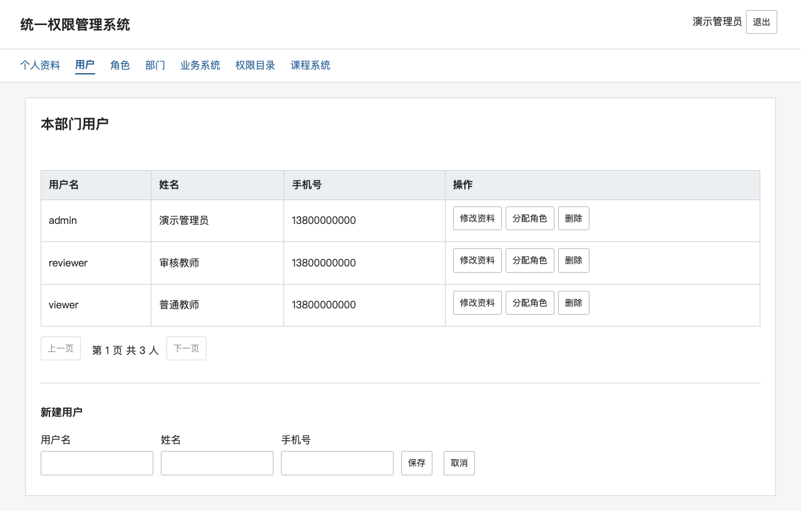
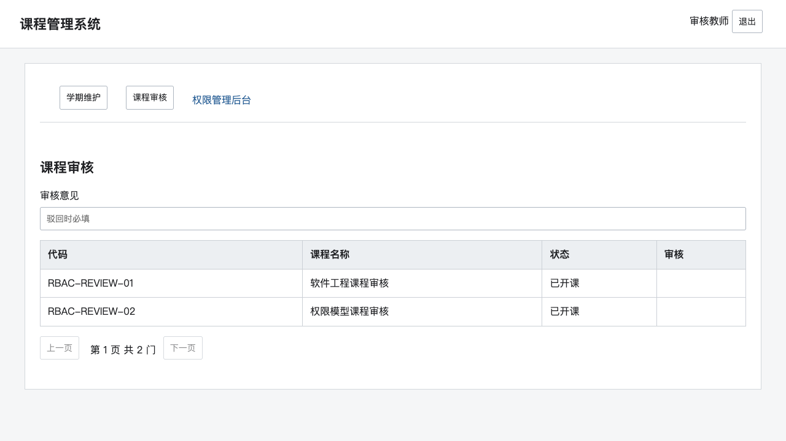
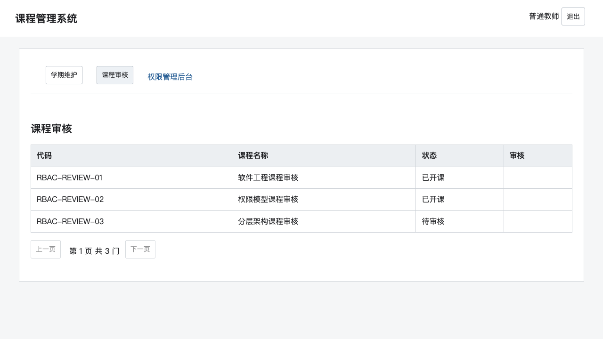

# v3.3.0 实施报告

验收日期：2026-11-17。基线为 v3.2.2 与本轮确认决定，代码、接口、图稿和两份说明书同步修订。

## 交付与运行

- 权限管理后台：<http://113.44.144.119/platform/>
- 课程接入演示：<http://113.44.144.119/course/>
- [概要设计 PDF](../redesign/统一权限管理系统概要设计说明书-v3.3.0.pdf)
- [需求与详细设计 PDF](../redesign/统一权限管理系统需求与详细设计说明书-v3.3.0.pdf)
- [设计源文件包](../redesign/统一权限管理系统设计-v3.3.0.zip)

用户和角色各归属一个部门。用户角色、角色权限采用两组多对多关系；管理范围为本部门直接成员。平台后台登记为 `rbac`，教师课程系统登记为 `course-project-management`。登录沿用老师的 `username`、`password`、`systems` 契约，`password` 承载手机号，`systems` 只接收一个目标系统。每个受保护请求验证 JWT、持久化会话和当前系统登录权限，操作权限实时查询。

API、Service Port、认证与基础设施共用，五个业务端口分别提供结构化、DDD 实现。`BACKEND_STRATEGY=structured|ddd` 在启动时选择，服务器最终恢复为 `structured`。Java 21、Spring Boot 4.1.2、Spring JDBC 和 MySQL 8.4 构成后端；Vue 3 与 TypeScript 提供两个前端入口。

合成演示账号如下，手机号均为 `13800000000`。

| 账号 | 用途 |
| --- | --- |
| admin | 权限后台管理 |
| reviewer | 课程学期维护与审核 |
| viewer | 课程只读 |
| other | 其他部门边界验证 |

老师课程仓库固定为 `c96efa2ee7f760d126a4476ce5e4772ff64ebe11`，通过仓库中的集成补丁启用统一身份。CloneFactory 0.0.2 源码固定为 `57c53ffb8574d95c0ee1daa3d08b55c66f2ff6ea`，保留原许可；编译生成请求 record 到 Command 的拷贝方法。API、应用服务与存储层使用 SLF4J 和 Logback，记录操作、结果及耗时。领域对象保持框架无关。

## 自动化与真实联调

| 检查 | 结果 |
| --- | --- |
| StructuredContractTest | 11 项通过 |
| DddContractTest | 11 项通过 |
| DomainTest | 3 项通过 |
| 教师 CloneFactoryTest | 5 项通过 |
| TypeScript 检查与两个生产构建 | 通过 |
| 业务依赖方向检查 | 通过 |
| 本地平台与真实课程后端联调 | 19 项 HTTP 检查通过 |
| Swarm 平台与真实课程后端联调 | 19 项 HTTP 检查通过 |

契约测试使用 Testcontainers MySQL，覆盖输入白名单、分页、部门隔离、用户角色、角色权限并集、撤权、会话、引用冲突以及 400、404、405 映射。未知字段不能通过普通资料修改改变部门或身份。具体套件数据见 [test-summary.json](test-summary.json)。

真实课程联调包含学期新增、修改、删除，课程查询、审核，低权限调用拒绝，撤销 CR 后旧令牌返回 403，恢复授权后审核成功，以及退出后原令牌返回 401。记录见 [smoke-local.json](smoke-local.json) 和 [smoke-swarm.json](smoke-swarm.json)。

浏览器完成平台用户新增、资料修改、角色分配、撤销和删除；读取角色权限；课程学期新增、修改、删除；审核待审核课程；只读账号查看列表。最新平台页和课程页控制台均无错误。临时账号、临时学期已清理；已通过的课程保留原结果，另留 `RBAC-REVIEW-03` 待审核供演示。浏览器检查发现并修复了前端把 201 空响应当作 JSON 解析的问题。







## 部署与资源

复用原三节点 Swarm，第四台作为压测客户端和备份副本节点。新项目使用独立 `rbac_v33` Stack、加密 Overlay、数据库和日志卷、Docker Secret。数据库不发布端口。Nginx 对两个前端及两个后端进行路径路由，上游使用 HTTP/1.1 和 keepalive。

| 节点 | 本项目用途 | 保留服务 |
| --- | --- | --- |
| 113.44.144.119，2 vCPU，1800 MiB | Nginx、RBAC、课程应用 | Prometheus、node-exporter |
| 119.3.221.88，2 vCPU，1800 MiB | MySQL 8.4.13 | MongoDB、node-exporter |
| 120.46.176.79，2 vCPU，792 MiB | 保持原服务 | lab4-app、node-exporter |
| 1.92.106.198，2 vCPU，792 MiB | 压测与备份副本 | Python 18090、node-exporter |

| 服务 | 实测内存快照 MiB | 容器上限 MiB |
| --- | ---: | ---: |
| RBAC，structured | 224.8 | 384 |
| 课程应用 | 401.9 | 512 |
| Nginx | 4.066 | 64 |
| MySQL | 241.4 | 512 |

这是负载后的单次快照。DDD 测量后 RBAC 曾采样为 243.7 MiB。四个项目服务均为 1/1 且健康；原容器及辅助节点 Python 监听仍在。[runtime-inventory.json](runtime-inventory.json) 保存采样结果，[layer-log-sample.txt](layer-log-sample.txt) 保存同一用户角色请求在 API、业务和存储层的日志片段。

部署时发现本地多架构 MySQL 镜像经 tag/save 后带入 ARM 镜像，amd64 节点出现 exec format error。现运行 worker 原有的 amd64 MySQL 8.4.13；构建工具改为固定 amd64 manifest，并对所有镜像检查 Architecture。静态资源根路径和前端空响应处理也已修复。

入口采用 IP 与 HTTP 的课程演示配置。入口、应用和数据库为单副本，单 Manager 和数据库节点故障会中断服务；恢复验证覆盖进程、依赖与备份恢复。

## 性能基线

辅助节点使用 Python urllib 经公网 HTTP 访问 Manager，每次客户端请求新建连接。每轮登录后预热 100 次，再计时 1,000 次；混合请求中权限查询与用户列表各占 50%。负载为 `GET /auth/permissions/user.view` 与 `GET /api/users?page=0&size=20`。两种策略共用镜像、连接池 5、资源限制、DEBUG 分层日志和数据库。

测量数据为 2 个部门、5 个用户、3 个角色、2 个系统、17 项权限、4 条用户角色和 26 条角色权限关联。本部门列表返回 4 个用户。全部测量结束后删除临时用户，目前剩 4 个用户及 3 条用户角色关系。

| 实现 | 并发 | 轮次 | req/s | P50 ms | P95 ms | 最大 ms | 错误 |
| --- | ---: | ---: | ---: | ---: | ---: | ---: | ---: |
| structured | 1 | c1 | 93.4 | 9.29 | 13.37 | 1034.49 | 0 |
| structured | 4 | c4 | 328.14 | 11.2 | 18.25 | 109.02 | 0 |
| structured | 8 | 1 | 278.54 | 25.57 | 52.61 | 151.66 | 0 |
| structured | 8 | 2 | 352.19 | 19.82 | 40.98 | 140.21 | 0 |
| structured | 8 | 3 | 437.77 | 15.34 | 36.67 | 62.01 | 0 |
| ddd | 1 | c1 | 120.77 | 8.11 | 10.96 | 88.81 | 0 |
| ddd | 4 | c4 | 405.32 | 9.58 | 14.39 | 26.35 | 0 |
| ddd | 8 | 1 | 265.92 | 27.07 | 55.83 | 125.86 | 0 |
| ddd | 8 | 2 | 256.37 | 20.04 | 41.68 | 1025.15 | 0 |
| ddd | 8 | 3 | 414.15 | 16.12 | 36.9 | 154.5 | 0 |

正式测量共 10,000 次请求，错误数为 0。8 并发三轮 P95：结构化 36.67 至 52.61 ms，DDD 36.90 至 55.83 ms。JVM 预热、公网及共享节点负载导致轮次波动；这组数据建立当前小规模数据集的回归基线。原始逐轮数据为本目录 `benchmark-structured-*.json`、`benchmark-ddd-*.json`。

调整连接复用前，一轮 1,000 次测试出现 2 个 504，错误率 0.2%，P95 32.92 ms，吞吐 273.07 req/s。Nginx 日志在 02:00:45 UTC 记录连接上游 VIP 超时，对应请求未到达 RBAC。启用上游 keepalive 后重新执行全部正式测量。[benchmark-initial-8.json](benchmark-initial-8.json) 保留初始结果。切回结构化时，压测脚本曾在新任务健康前开始登录而收到 504，随后按新任务配置和健康状态等待再完成测量；策略切换采用 stop-first，会有短暂中断。

## 恢复与数据校验

| 场景 | 观测结果 | 证据 |
| --- | --- | --- |
| force 更新 RBAC 任务 | 首次失败请求至恢复 34.477 s，原令牌继续可用 | [restart.json](restart.json) |
| RBAC 副本降至 0 后恢复为 1 | 课程接口返回 503，首次失败至恢复 39.365 s，原课程令牌继续可用 | [dependency.json](dependency.json) |
| 两库备份与恢复 | 隔离 MySQL 导入成功，源库与恢复库规范化数据摘要一致 | [backup-restore.json](backup-restore.json) |

恢复观测间隔为 0.5 秒加请求耗时，时长从首次失败响应采样点起算。故障期间平台入口出现 502/504，课程端将身份依赖故障映射为 503。故障测试时数据库和密钥持续可用。

`deploy/backup.sh` 使用 single-transaction 导出两个数据库。恢复测试在 Worker 1 创建独立、无网络、384 MiB 的临时容器，导入后按主键排序导出数据比较 SHA-256，随后清理临时容器及卷。原数据库保持运行。备份副本保存于第四台 `/opt/rbac-v33/backups/verified.sql.gz`，两节点与本地文件 SHA-256 均为 `f27b57498f8353cd1df5d59ad5fcc01f5441d19be84dd18769bd4c95afe9d113`。源库与恢复库数据摘要均为 `887850ac07f30e2d0014e541ac35c17c9193bbef7b69e63f1460f6ba1f2b6819`。数据库转储和私钥保存在受限运行目录，Git 保存验证结果。

## 文档与模型

概要设计按课程要求组织九章，包含四个 ATAM 六要素场景、效用树、风险与权衡、粗粒度设计类、状态、平衡 DFD、三张系统级时序、接口、全局数据与部署。需求与详细设计按七章组织，35 个平台 HTTP 操作和 7 个课程 API 的交互图放在对应功能下。

当前交付 102 张黑白图稿，含 99 张 UML 图、陈氏 ER、表关系和技术会话表，保留 StarUML 模型、SVG、PNG 及人工坐标源文件。PDF 使用统一 A4 纵向、V2 字体字号和用例表风格。重建入口为 `tooling/build-design.sh`，模型引用、图片路径、SVG 文字边界及 PDF 页尺寸由构建检查，最终导出另作逐页视觉检查。

## 复现入口

```sh
./tooling/test.sh
python3 tooling/check-architecture.py
./tooling/prepare-course.sh
./tooling/build-images.sh
./tooling/build-design.sh
```

性能脚本 `tooling/benchmark.py` 从 `RBAC_DEMO_PHONE` 读取合成登录值；恢复观测使用 `tooling/resilience.py`；远程批处理使用 `tooling/remote.py` 交互读取 SSH 凭据。部署步骤见 [部署说明](../../deploy/README.md)。
