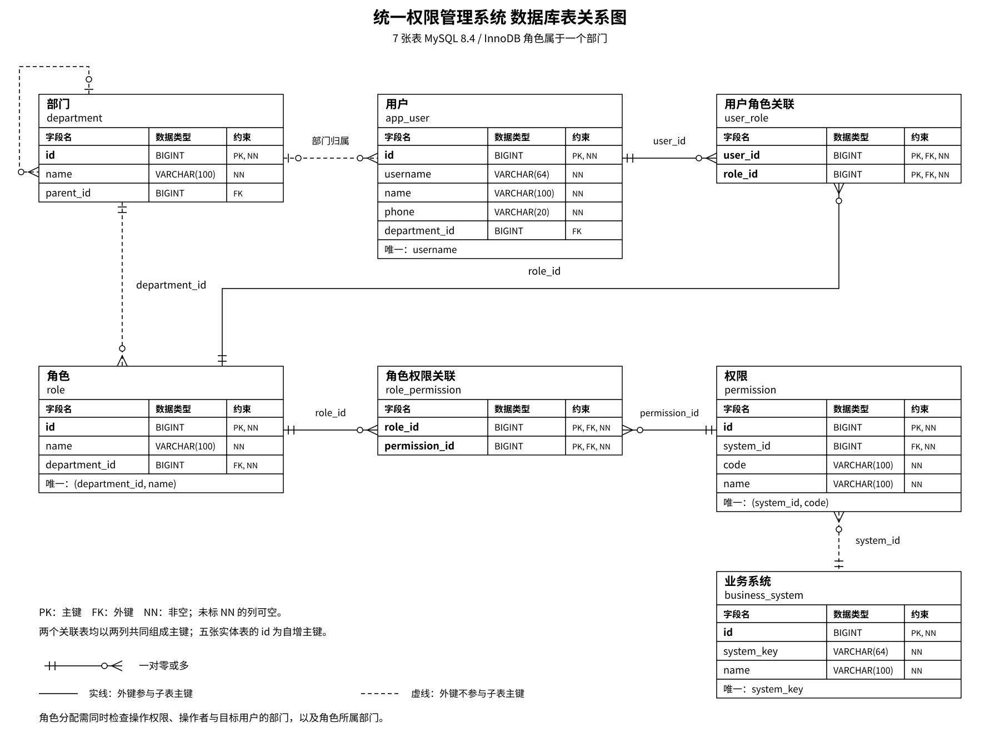

# 数据库表设计 v0.3

2026-11-08 修订，评审草案。对应[陈氏 ER 概念图](第一版设计.md)，建表脚本为 [schema.sql](sql/schema.sql)。采用 MySQL 8.4 / InnoDB，共七张表。用户是否允许多部门尚未确认，暂按至多一个部门。

[高清 PNG](assets/rbac-schema-v1.png)；[StarUML 可编辑基本图元](assets/rbac-schema-v1.mdj)。StarUML 文件用于逐项编辑图形，不是可自动生成 SQL 的原生 ERD 模型。人工坐标保存在 [draw_models.py](tools/draw_models.py)，用于同步导出图片与图元。

## 关系与转换依据

| 概念联系 | 基数 | 物理表示 |
| --- | --- | --- |
| 部门下设部门 | 1:N | `department.parent_id` 自引用，可空；根部门无父部门 |
| 部门包含用户 | 1:N | `app_user.department_id` 可空；暂允许用户未分配部门 |
| 部门设有角色 | 1:N | `role.department_id` 非空；每个角色只属于一个部门 |
| 用户分配角色 | M:N | `user_role`，两列共同组成主键 |
| 角色拥有权限 | M:N | `role_permission`，两列共同组成主键 |
| 系统定义权限 | 1:N | `permission.system_id` 非空；每项权限属于一个系统 |

部门—角色为一对多，因此通过角色表外键表示，不建立 `department_role` 表。部门管理员只可给本部门用户分配本部门角色，实际权限仍通过用户—角色—权限计算，部门归属不会自动授予权限。

用户可登录的系统由 `app_user -> user_role -> role -> role_permission -> permission -> business_system` 推导；系统内操作由同一路径的权限编码判断。`user_role` 与 `role_permission` 分别保存两个独立的多对多事实，均有必要。`permission.system_id` 已确定权限的系统，无需在 `user_role` 重复保存 system_id，也无需再建立角色—系统—用户三方表。

图采用鱼尾符号：圆圈表示零，竖线表示一，鱼尾表示多；端点表达该侧的最小和最大基数。实线表示外键参与子表主键的标识关系，虚线表示不参与子表主键的非标识关系。字段名、类型、约束分栏，唯一约束写在表下注释中。

符号依据：[MySQL Workbench EER 官方说明](https://dev.mysql.com/doc/workbench/en/wb-eer-diagrams-section.html)及[外键关系表示说明](https://dev.mysql.com/doc/workbench/en/wb-relationship-tools.html)。表在画布中的坐标由本项目手工安排，官方资料没有规定这些坐标或固定排列顺序。

## 字段定义

五张实体表使用自增 BIGINT 主键，对应 Java Long，创建后不修改。两张关联表使用联合主键，无额外 id。PK 为主键、FK 为外键、NN 为非空；下列可空列仅有部门的父部门与用户的所属部门。

### department：部门

| 字段 | 类型 | 可空 | 约束与含义 |
| --- | --- | --- | --- |
| id | BIGINT | 否 | 自增主键 |
| name | VARCHAR(100) | 否 | 部门名称 |
| parent_id | BIGINT | 是 | 外键，指向 department.id；根部门为 NULL |

索引 `idx_department_parent(parent_id)` 支撑查询直属子部门。允许多个根部门、部门重名。Service 检查部门不能以自身或后代为父部门，外键只保证父部门存在。

### app_user：用户

| 字段 | 类型 | 可空 | 约束与含义 |
| --- | --- | --- | --- |
| id | BIGINT | 否 | 自增主键 |
| username | VARCHAR(64) | 否 | 全局唯一，区分大小写 |
| name | VARCHAR(100) | 否 | 姓名 |
| phone | VARCHAR(20) | 否 | 手机号，字符串保存；不单独唯一 |
| department_id | BIGINT | 是 | 外键，指向 department.id |

唯一索引 `uk_app_user_username(username)` 支撑登录定位；`idx_app_user_department(department_id)` 支撑按部门查询用户。不保存启用／禁用状态，员工离开时删除账号及其用户角色关联。登录使用用户名＋手机号，系统标识另行提交，再通过角色检查目标系统的登录权限。2026-11-12 确认登录请求以 `password` 字段承载手机号，并与本表 `phone` 校验；不因此新增数据库密码列。日志不记录该凭据。

### role：角色

| 字段 | 类型 | 可空 | 约束与含义 |
| --- | --- | --- | --- |
| id | BIGINT | 否 | 自增主键 |
| name | VARCHAR(100) | 否 | 角色名称，部门内唯一 |
| department_id | BIGINT | 否 | 外键，指向 department.id；角色只属于一个部门 |

唯一索引 `uk_role_department_name(department_id, name)` 同时支撑部门内角色防重与按部门查询角色。不同部门可以建立同名角色，它们是不同角色记录。角色不保存管理范围枚举；分配角色时检查角色所属部门，不另建部门可分配角色表。

### business_system：业务系统

| 字段 | 类型 | 可空 | 约束与含义 |
| --- | --- | --- | --- |
| id | BIGINT | 否 | 自增主键 |
| system_key | VARCHAR(64) | 否 | 系统标识，全局唯一，如 rbac、oa |
| name | VARCHAR(100) | 否 | 系统名称 |

唯一索引 `uk_business_system_key(system_key)` 支撑按系统标识查询。权限管理后台也登记为业务系统。无 OAuth 客户端密钥、回调地址、部门可用系统字段。

### permission：权限

| 字段 | 类型 | 可空 | 约束与含义 |
| --- | --- | --- | --- |
| id | BIGINT | 否 | 自增主键 |
| system_id | BIGINT | 否 | 外键，指向 business_system.id |
| code | VARCHAR(100) | 否 | 系统内权限编码，如 login、user.delete |
| name | VARCHAR(100) | 否 | 权限名称 |

唯一索引 `uk_permission_system_code(system_id, code)` 支撑系统内权限防重和按系统查询权限。不同系统可以定义相同编码。权限表不存角色或部门。

### user_role：用户角色关联

| 字段 | 类型 | 可空 | 约束与含义 |
| --- | --- | --- | --- |
| user_id | BIGINT | 否 | 联合主键、外键，指向 app_user.id |
| role_id | BIGINT | 否 | 联合主键、外键，指向 role.id |

主键 `(user_id, role_id)` 防止重复分配，并支撑按用户查询角色。索引 `idx_user_role_role(role_id)` 支撑反向查询持有角色的用户。

### role_permission：角色权限关联

| 字段 | 类型 | 可空 | 约束与含义 |
| --- | --- | --- | --- |
| role_id | BIGINT | 否 | 联合主键、外键，指向 role.id |
| permission_id | BIGINT | 否 | 联合主键、外键，指向 permission.id |

主键 `(role_id, permission_id)` 防止重复授权，并支撑按角色查询权限。索引 `idx_role_permission_permission(permission_id)` 支撑反向查询持有权限的角色。

## 校验、分配与删除

Controller 使用专用 DTO 限定可修改字段，校验非空、格式与长度；Service 检查需要业务上下文的规则。文本去除首尾空白后再保存。数据库 CHECK 保证必要文本不全为空白；用户名、系统标识及权限编码区分大小写。中文字段使用 utf8mb4，系统标识、权限编码、手机号使用 ASCII。

部门管理员分配角色时，须同时满足：持有角色分配操作权限；操作者与目标用户的部门相同且非空；待分配角色的 department_id 与该部门相同。同部门角色可以含敏感管理权限，因此维护角色权限集合仍须独立检查相应权限，不能让管理员通过修改角色权限绕过限制。平台级初始化与管理用例边界留待接口设计确定，不增加 ALL 范围字段。

用户—角色两个独立外键不能自动保证二者同部门，这项跨表约束由 Service 在事务内检查。普通资料修改不允许改变部门和角色；本版不提供部门调动，避免分配后部门变化使原授权失效规则含糊。

所有外键采用 RESTRICT。删除用户时先清除其 user_role，再在同一事务中删除用户；删除角色须先处理 user_role 和 role_permission；删除权限须先处理 role_permission；删除系统须先处理其权限；删除部门须先处理直属用户、角色和子部门。外键阻止遗漏关联导致孤立记录。

不增加审计、批量导入导出、逻辑删除、版本号、账号状态或管理范围字段。事务、外键和唯一约束不替代业务权限校验。

## 当前未确定事项

用户是否多部门、是否必须归属部门；部门管理员是否管理子部门。登录成功使用 Session＋Cookie，不增加会话业务表。若用户允许多部门，需要重新设计用户—部门关系与角色分配规则，不能只添加关联表。
