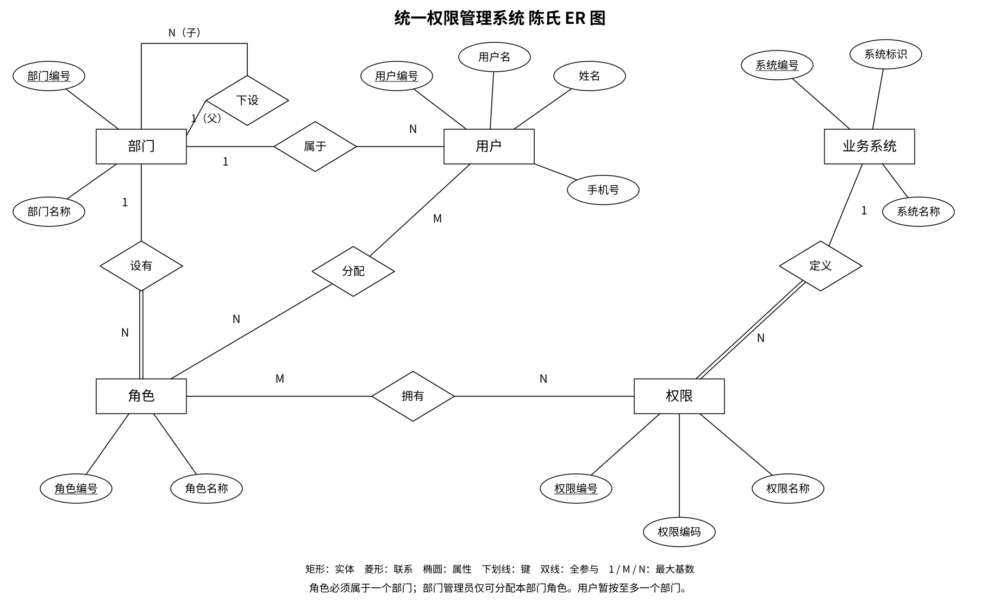

# 统一权限管理系统重做：第一版设计

2026-11-12 修订。状态：评审草案，尚未实现。分支 `codex/rbac-redesign`，从 `main` 创建。旧说明保留作历史参考，本目录记录本次重做。

## 已确认的范围

保留用户、部门、角色、权限、业务系统管理，以及简单登录和操作鉴权。员工、用户、账号统一为“用户”。管理后台自身也通过角色取得权限。

删除审计、批量操作、导入导出、公司实体、角色模板、部门—系统授权关系和 OAuth/OIDC；本版不做部门调动、审批、跨系统免登录、分布式缓存、压测平台或复杂版本交互。后续是否增加功能另行讨论。

登录使用用户名、手机号和目标系统标识。2026-11-12 确认：请求字段 `username` 传用户名，`password` 传手机号；平台按用户名查找账号，再校验 `password` 与账号的 `phone` 一致。本版手机号就是登录密码，不另设独立密码、短信或第三方认证协议。日志不得记录 `password`、完整手机号或令牌。

外部 Apifox 示例的 `username`、`password` 字段可按上述约定对应；如沿用其 `systems` 数组字段，本版只传一个目标系统，例如 `{"username":"zhangsan","password":"13800138000","systems":["course-project-management"]}`。这只确认登录输入的对应关系，JWT、有效期和其他鉴权接口尚未确认为本项目契约。

## 陈氏 ER 概念图

源文件：[StarUML 项目](assets/rbac-chen-v1.mdj)。PNG 用于预览，SVG 用于排版。所有实体只出现一次，没有分区引用或重复画实体。

图采用经典陈氏符号：实体用矩形、联系用菱形、属性用椭圆、键属性加下划线，联系边标最大基数。权限参与“定义”联系、角色参与“设有”联系的一侧用双线，分别表示每项权限必须归属一个系统、每个角色必须归属一个部门；其余联系使用单线。部门的递归联系区分父、子两种参与角色。用户—角色与角色—权限在概念图中画为 M:N 联系，转为关系模型时再建立中间表。

StarUML 内置 ERD 使用的是表格与鱼尾表示。本图用 StarUML 的可编辑基本图元逐个定位，保持陈氏画法；项目中的容器虽为 UMLClassDiagram，本图语义仍是陈氏概念图，并非 UML 类图。矩形、属性椭圆、文字和线条可编辑，基本图元不会自动生成数据库。移动关系菱形时需要同时调整其四条边及文字。

| 实体 | 含义与必要属性 |
| --- | --- |
| 用户 | 一个员工账号；用户编号、用户名、姓名、手机号 |
| 部门 | 多级组织节点；部门编号、部门名称；父子关系通过“下设”表达 |
| 角色 | 可授予用户的权限集合；角色编号、角色名称 |
| 权限 | 一项可检查的操作；权限编号、权限编码、权限名称 |
| 业务系统 | 权限所属的软件系统；系统编号、系统标识、系统名称 |

权限管理后台自身登记为一个业务系统，无需另外设计后台专用授权模型。角色可以包含多个系统的权限。每个角色归属一个部门，部门管理员只能分配本部门角色；部门不直接绑定系统或权限。

| 联系 | 第一版约束 |
| --- | --- |
| 部门下设部门 | 一个父部门可以有多个子部门；子部门最多一个父部门；根部门无父部门；禁止成环 |
| 用户属于部门 | 暂按用户至多一个部门，部门可以有零个或多个用户；是否必须归属、是否允许多部门仍待确认 |
| 用户分配角色 | 双向多对多，双方都允许没有关联；同一用户可以持有多个角色 |
| 部门设有角色 | 一对多；每个角色必须属于一个部门，部门可有零个或多个角色；部门管理员只可分配本部门角色 |
| 角色拥有权限 | 双向多对多，双方都允许没有关联；不设置角色继承或否定权限 |
| 系统定义权限 | 一个系统可以有零个或多个权限；每项权限必须属于一个系统 |

## RBAC 如何覆盖登录与管理

用户的有效操作权限是其所有角色权限的并集。没有角色或角色没有对应权限时拒绝。用户删除后，其关联授权记录一并按事务处理。

本版以用户—角色分配、角色—权限分配作为唯一授权来源。系统标识用于定位权限所属系统，部门用于约束角色归属与管理边界；二者都不能绕过角色直接向用户授予权限。部门归属约束是本项目已明确的组织规则，不是基础 RBAC 自动提供的能力。

| 需求 | 使用现有关系实现 | 无需另建的关系 |
| --- | --- | --- |
| 用户能否登录系统 | 用户经 `user_role`、`role_permission` 取得该系统的 `login` 权限 | 用户—系统、部门—系统授权 |
| 用户能否执行操作 | 同一路径检查目标系统内的操作权限编码 | 用户直接权限、角色—系统—用户三方授权 |
| 部门管理员可分配哪些角色 | 先检查 `user.role.assign`，再检查操作者、目标用户和角色的部门一致 | 部门—权限、重复的部门—角色关联表 |

例如，用户甲持有角色 R，R 拥有 OA 的 `login` 和 `document.view` 权限，则甲可以登录 OA 并查看文档。R 未授予财务系统的 `login` 权限时，甲不能登录财务系统。用户、角色、权限的已有连接已经表达该结果，不再存一条“甲—OA—R”记录。

每个系统定义一项登录权限，例如 OA 的 `login`。业务系统提交用户名、手机号、系统标识；平台确认身份后，再检查该用户是否通过角色取得目标系统的登录权限。系统内的查看、修改等权限分别配置，获得登录权限不自动获得其他操作权限。权限唯一性按“系统标识＋权限编码”确定。

管理后台同样定义 `user.view`、`user.edit`、`user.delete`、`user.role.assign`、`role.manage`、`permission.manage`、`system.manage`、`department.manage` 等权限。管理员也是普通用户实体，通过配置相应角色成为管理员，不增加 `superAdmin`、`departmentAdmin` 身份字段。

### 部门与角色的分配限制

“部门有哪些权限”在本版解释为：部门成员通过分配到的角色取得权限。部门节点不独立持有权限，不增加部门—权限表或部门—系统表，也不自动向全体部门成员继承权限。

部门管理员的数据范围由其所属部门确定；角色通过 `role.department_id` 归属一个部门，部门管理员只能分配本部门的角色；不设置管理范围枚举。部门管理员默认只处理本部门直接成员，子部门是否包含在内留待确认。

例：用户甲属于研发部，获得“部门用户管理员”角色，该角色拥有 `user.view`、`user.delete`，范围为本部门。甲能处理研发部用户，不能处理财务部用户，也不能因为是管理员就维护系统或权限目录。

角色分配须检查操作者、目标用户及待分配角色的部门相同，并检查操作权限；单有部门归属不代表取得权限。角色和权限目录维护仍需相应管理权限。

部门内的查看、修改、删除也须先取得各自的操作权限，再限制目标用户属于本部门。同部门校验本身不会授予任何操作。角色名称只用于展示，不以“管理员”等名称判断权限，不设置按用户名或身份标记绕过鉴权的逻辑。

## 关系模型初稿

字段类型、主外键、索引与删除规则详见[数据库表设计](数据库表设计.md)，建表脚本为 [schema.sql](sql/schema.sql)。

暂按七张表落地，不在概念图中提前混入外键、SQL 类型或索引。

| 表 | 必要字段 | 主要约束 |
| --- | --- | --- |
| `department` | `id, name, parent_id` | 父部门自引用，可空；不能形成环 |
| `app_user` | `id, username, name, phone, department_id` | 用户名唯一；部门暂允许为空 |
| `role` | `id, name, department_id` | 必须属于一个部门；部门内角色名称唯一 |
| `business_system` | `id, system_key, name` | 系统标识唯一 |
| `permission` | `id, system_id, code, name` | 系统编号非空；系统内权限编码唯一 |
| `user_role` | `user_id, role_id` | 两列组成联合主键与外键 |
| `role_permission` | `role_id, permission_id` | 两列组成联合主键与外键 |

不设置员工—系统—角色三方绑定表。两个中间表表达用户—角色、角色—权限的多对多关系，不额外建立分配任务、模板、授权历史或审计实体。

## 参考老师仓库的四层结构

| 层 | 职责 | 建议包 |
| --- | --- | --- |
| 输入输出层 | Controller、请求 DTO、响应 VO、Bean Validation、异常转 HTTP | `api.user`、`api.role`、`api.permission`、`api.department`、`api.system`、`api.auth` |
| Service Port | API 调用的用例契约与必要输入输出；安全适配接口 | `service.port`，内部按功能划分 |
| Service | 结构化版：事务脚本内编排规则；DDD 版：应用服务编排事务，领域模型执行业务规则 | `service.structured`、`service.ddd.application`、`service.ddd.domain`，内部按功能划分 |
| 基础设施 | JPA Entity、Spring Data Repository、持久化和 Spring Security 适配 | `infrastructure.persistence`、`infrastructure.security` |

2026-11-12 确认采用两套设计和实现：`service.structured` 提供结构化事务脚本；`service.ddd.application` 与 `service.ddd.domain` 提供 DDD 应用服务与领域模型。API、Service Port、Infrastructure 和七张数据库表共享。配置 `app.backend-strategy=structured|ddd` 在启动时只装配一套 Service，不在每次调用中用条件分支选择策略。不为每张表机械建立一整套 Controller、DAO、Gateway、Assembler。

Controller 使用专门 DTO 限定允许输入的字段，再用 `@Valid` 校验。Service 校验用户名是否重复、操作者权限和目标部门范围等需要业务上下文的规则。删除用户是删除操作；普通资料更新不接收主键、部门或角色修改。部门调动接口本版不建立。

以下只明确接口与模型的对应，完整请求和响应契约留到实现前确定。

| 用例 | 对应资源或关系 | 鉴权要求 |
| --- | --- | --- |
| 简单登录 | 用户、目标系统的登录权限 | 匹配用户名与手机号，再通过角色检查 `login` |
| 查看／修改／删除用户 | 用户；删除时清除用户角色关联 | 分别检查 `user.view`、`user.edit`、`user.delete` 及部门约束 |
| 给用户分配／撤销角色 | `user_role` | 检查 `user.role.assign` 及部门约束 |
| 配置角色的权限 | `role_permission` | 检查 `role.manage` 及适用的部门约束；角色分配权限不等于角色权限配置权限 |

当前分支只有设计文档、图和建表 SQL，尚无后端 API 或 Java 实现。因此本轮核对结论只覆盖设计，不能据此宣称接口和业务代码已完成整改。实现时沿用上述关系和四层职责，不另设三方角色分配模块。

### CloneFactory

依赖老师仓库的 `cn.edu.xmu:clonefactory:0.0.1-SNAPSHOT`，参考课程管理示例使用 `provided` 与显式 `annotationProcessorPaths`。新环境先构建并安装老师的独立 CloneFactory 工程，不在业务项目里改写一个同名工具。

用 `@CopyFrom`、`@CopyTo` 等声明允许的转换，在编译时生成 `CloneFactory.copy`。DTO 转业务输入、结果转 VO 等同名字段转换使用该工具；主键、部门等敏感字段由专用用例控制，必要时使用排除注解。它不代替权限判断和业务校验。

Spring Security 用于保存和读取当前认证身份及权限；RBAC 从用户、角色、权限关系计算。登录使用 Session＋Cookie；会话保存用户编号和单个目标系统标识，后续操作按当前 RBAC 关系重新校验权限。登录成功更新会话标识，退出销毁会话；写请求保留 CSRF 校验。本版不引入 JWT、OAuth/OIDC、分布式会话或权限缓存。框架版本待实现时核验兼容性，不直接照抄示例 POM 的版本号。

## 画法与实现参考

本次实际查阅的是教材课件、大学课程讲义和老师的仓库。未采用网上生成式图片作标准。不同教材的 ER 符号存在变体，本版选用属性椭圆式陈氏画法，整张图保持一致。

- [Peter Chen：The Entity-Relationship Model，原论文前五页](https://www.csc.lsu.edu/~chen/pdf/erd-5-pages.pdf)：实体、联系、属性及递归联系的概念依据；该公开节选未覆盖完整绘图规范。
- [开普敦大学数据库课程：Entity-Relationship Modelling](https://www.cs.uct.ac.za/mit_notes/database/htmls/chp06.html)：实体、属性、联系和基数；讲义明确提到属性椭圆与框内属性两种表示。
- [Database System Concepts：第六章课件](https://www.db-book.com/slides-dir/PDF-dir/ch6.pdf)：核对实体、联系、键和参与约束；其主图采用框内属性，未直接照搬为本版陈氏图。
- [老师的课程管理后端设计](https://gitee.com/mingqcn/course-project-mgt/blob/master/docs/backend-design.md)：四层职责及 CloneFactory 方案；查阅版本 `36e0482`。
- [老师的 CloneFactory 指南](https://gitee.com/mingqcn/spring-fundamentals/blob/master/clonefactory/doc/ReadMe.md)：注解处理器和字段排除；查阅仓库版本 `dce89a4`。

## 待核对的决定

1. 用户是否允许多个部门；本图先按至多一个部门。
2. 部门管理员是否包含子部门数据范围。
登录凭据已于 2026-11-12 确认为 Session＋Cookie。

## 日志要求

各可执行层通过 SLF4J 记录日志，由 Logback 统一输出；API 记录请求结果与耗时，Service 记录用例结果与权限拒绝，Infrastructure 记录持久化及适配失败。Service Port 的接口与数据类没有执行过程，不人为添加日志方法。DDD 领域对象不依赖 Logback 实现，规则拒绝由应用层记录。凭据、完整手机号、Cookie、Session ID 不写入日志；同一异常只在统一边界完整记录一次。运行日志不恢复业务审计模块，也不新增数据库表。
