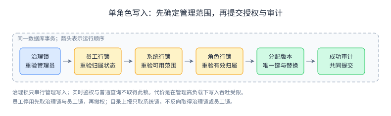

# 统一权限管理系统实现设计记录

更新：2026 年 10 月 24 日

行为基线为需求规格 2.1，源码边界以分析与设计指南为准。实现使用 Java 21、Spring Boot 3.5.16、Spring Authorization Server 1.5.8 和标准 OIDC 授权码流程。此文档记录已经实现的接口、持久化和并发约束；业务要求仍以需求规格为准。

模块职责如何继续形成操作契约、HTTP 接口和关系表，以及 ER 图怎样绘制，见[接口与数据库设计指南](thinking/统一权限管理系统接口与数据库设计指南.md)。本文保留为实现事实速查，不重复展开学习推导。

平台包含六个业务包。每个包通过 `api` 子包公开不可变事实与能力，持久化实体和 Repository 保持在本模块内部。`application` 只协调跨模块用例，不拥有业务数据。

认证和统一会话由 `identity` 维护。系统登记及 OIDC 客户端配置属于 `integration`。登录结果通过框架兑换，业务权限由 `authorization` 实时判断；ID Token 不代表操作权限。

数据库使用 Flyway 迁移和 JPA 校验。每员工每系统单角色通过唯一键和版本冲突检测维护；管理变更及审计在同一事务提交。独立 MySQL 测试验证事务和竞争结果，ArchUnit 验证源码边界。

初始化分别提供基础、演示及压测模式。演示配置和压测副本不改写教师提供的 Excel。演示、纯基础、测试与压测分别使用 `upms`、`upms_baseline`、`upms_test` 和 `upms_load`，测试与压测不得指向演示库。

课程提交使用[七章 AsciiDoc 综合说明书](统一权限管理系统需求与详细设计说明书.adoc)；[公开 API](https://3wq8lbigke.apifox.cn/) 与[口试交付验收报告](口试交付验收报告.md)记录本轮交付。

## 模块与状态归属

源码根目录为 `platform/src/main/java/cn/edu/upms/`。

| 模块 | 拥有的状态 | 对外能力及依赖 |
| --- | --- | --- |
| identity | 八小时统一会话、框架授权及令牌索引、节点签名密钥 | 登录、令牌来源验证、退出；读取 organization、integration，写 audit |
| organization | 公司、部门、员工、固定管理员身份 | 组织维护、范围核验、治理锁；写 audit |
| integration | 系统登记、独立凭据哈希、可用部门、目录版本 | 系统维护与客户端事实；调用 organization、audit |
| catalog | 权限项、模板、部门角色与显式选择集合 | 目录接收、角色维护及复制；调用 integration、organization、audit |
| authorization | 单角色分配、批量任务及结果、可选权限快照 | 写入、有效事实、纯判断；调用前四模块与 audit |
| audit | 关键事件、故障闸门、运行统计 | 同事务记录、范围查询、故障恢复；不反向依赖业务模块 |

模块内 Service 是应用用例，Repository 负责本模块实体存取。身份协议和 HTTP 是适配工作，分别放在 identity 与 application；有效权限规则 `EffectivePermissionRule` 不依赖 Spring、JPA 或 Web。没有同时引入 MyBatis，也没有把每项 CRUD 包装成一套端口和适配器。

## 已实现的 HTTP 能力

后台端点使用平台 HttpOnly 会话。写请求先从 `GET /api/csrf` 获取框架标记，并按返回的 `headerName` 携带。普通员工不能使用后台端点。响应错误使用 ProblemDetail 与稳定 `code`，409 要求刷新后重新确认，不能自动覆盖。

| 入口 | 方法与用途 | 重要约束 |
| --- | --- | --- |
| `/login`、`/logout` | GET 登录页，POST 登录与当前会话退出 | 用户名与手机号同时匹配；Demo 不提供密码安全强度；CSRF 必须校验 |
| `/.well-known/openid-configuration` | GET 发现文档 | issuer 按环境固定：本机 `http://localhost:18080`，服务器 `https://113.44.144.119` |
| `/oauth2/authorize`、`/oauth2/token` | 标准授权码与兑换 | PKCE S256、state、nonce、精确回调、60 秒码；并发兑换仅一次成功 |
| `/oauth2/jwks`、`/userinfo`、`/oauth2/introspect` | 公钥、身份资料、标准内省 | ID Token 无业务权限；内省补充统一会话失效与客户端归属 |
| `/connect/logout` | 标准 RP 发起退出 | 框架验证 ID Token hint 和已登记退出回调；只失效当前统一会话 |
| `/api/admin/me`、`/companies`、`/departments`、`/employees` | 身份、组织查询与维护 | 后三个路径均在 `/api/admin` 下；员工查询分页，范围由服务端强制 |
| `/api/admin/employees/{id}/state`、`/transfer` | POST 停用或人工调动 | 员工确认版本；调动先手工撤完全部角色并等待 3 秒 |
| `/api/admin/administrators` | POST 固定身份任免 | 最高管理员范围；至少一名有效最高管理员 |
| `/api/admin/systems`、`/systems/{id}/departments` | 查询、登记及可用范围替换 | 后一路径同样在 `/api/admin` 下；系统与部门多对多 |
| `/api/admin/systems/{id}/credentials` | POST 重新签发独立接入凭据 | 最高管理员确认版本，仅响应展示一次，no-store；不写明文日志 |
| `/api/admin/roles`、`/roles/copy`、`/roles/{id}/delete` | 查询、配置、复制及逻辑删除 | 后两路同前缀；系统归属不可改变；删除前须撤掉全部分配 |
| `/api/admin/employees/{id}/permissions`、`/roles/{id}/affected` | 查询有效权限及角色影响 | 后一路径同前缀；部门隔离 |
| `/api/admin/assignments` | POST 单角色分配、替换或撤销 | employeeId、systemId、roleId、expectedVersion；roleId=null 为撤销，首次版本为 -1 |
| `/api/admin/batches`、`/batches/{id}/retry` | POST 建立或明确重试，GET 查询 | 后一路径同前缀；1 至 100 个不同员工，整批范围预检；每项独立提交 |
| `/api/admin/audit`、`/audit/export` | GET 筛选及 CSV 导出 | 后一路径同前缀；部门、时间、类型、结果、对象筛选；防 CSV 公式注入 |
| `/api/runtime/check` | POST 实时鉴权 | Bearer 令牌；system 与 permission；员工身份不能由请求伪造；200 的 allowed=false 是正确拒绝 |
| `/api/directory/report` | POST 完整目录与递增版本 | 独立 `${system}-directory` 客户端及 directory.report 范围；不能执行员工鉴权 |

各业务系统后端用标准 OAuth 客户端保存令牌，浏览器只保存各应用的独立会话 Cookie。OA 的查看／新增与知识库的查询／编辑权限不同。“本人”由显式演示目录项表示，记录所有者检查在模拟系统完成。两个系统均不连接平台数据库。

## 持久化与事务

Flyway V1 建立组织、员工、系统、关联、权限、角色、选择、分配、审计、批量任务及初始化标记；V2 增加角色内容版本，V3 增加批量幂等键，V4 增加角色逻辑删除。JPA 使用 `validate`，不自动改表。

关键唯一性包括用户名、手机号、员工与系统分配、同范围角色名称及管理员批量请求标识。模板的部门为空，名称唯一还通过治理锁内的业务检查维护；不能仅依赖 MySQL 对 NULL 唯一键的处理。

图中箭头是运行顺序。例如两个管理员持同一旧分配版本换角，治理锁与员工锁确定先后，后执行者读取最新分配后收到 409。框架一级缓存通过 `refresh` 刷新员工事实，避免持锁后仍检查旧版本。目录上报只取系统锁，没有反向等待治理锁的路径。

治理锁使用固定总公司行，只串行管理写入，查询和鉴权不等待它。本期选较粗锁控制复杂度，代价是管理写入吞吐上限；正式管理员与混合负载用于判断是否需要细分。将来拆锁前须重新证明管理员取消、组织停用、调动与授权的竞态。

混合负载发现等待锁的写事务占用连接，故后台 POST 在进入应用用例之前使用四许可公平闸门，等待不占 JDBC 连接。等待最多两秒，超限返回明确 503；取得许可仍须校验身份、CSRF、管理范围与版本。这是针对连接竞争的资源约束，不能替代数据库锁与唯一键。

管理变更和成功审计同事务提交。批量任务先验证整批范围，再逐项将授权和成功结果共同提交；失败项目单独保存结果。相同请求标识在单节点串行，数据库唯一键提供最后约束；重试只接受用户确认的新版本，不重复成功项。重启将未完成项标为中断。

目录中的有效历史项不可遗漏，停用须明确 `active=false`。停用从角色选择中撤下，重新启用不会恢复旧权限，需管理员显式选择。新增权限同样不自动授予。逻辑删除角色保留历史审计和保留名称，不允许删除仍有分配的角色。

## 会话、故障与测量

统一会话使用不可变 Principal 与线程安全存储，最长八小时，访问不续期。访问令牌不透明，无刷新令牌，期限不超过统一会话剩余寿命。节点重启后签名密钥、协议授权及会话全部失效，持久化的业务配置保留。

Spring 单例对象不保存当前请求员工的共享可变字段。共享缓存、计数和会话均有明确的线程安全机制。授权码兑换的分段锁覆盖框架读取、判断、失效和保存全过程；成熟框架继续处理 PKCE、客户端与协议校验。

客户端凭据校验的有界缓存只保存 SHA-256 指纹和成功结果，键包含当前存储的凭据哈希。首次仍运行 BCrypt，换凭据后旧缓存不能命中；错误凭据不缓存。此优化针对正式登录测量发现的重复 BCrypt CPU 开销，不放宽协议校验。

业务权限缓存默认关闭。无缓存基线达标后不把中间件或缓存作为完成项目的条件。保留可选 `UPMS_CACHE=true` 实验：最多 20,000 项、从最早事实读取前起算两秒绝对期限，命中不续期，慢到超过期限的读取拒绝；分配提交后主动撤下该项。其它变更仍由绝对期限限制，快照不能代替统一会话核验。

审计存储每秒实际写入探测。失败时暂停新受控请求，管理变更回滚，新登录不报告成功；已经结束的会话不会因审计失败恢复。恢复事件记录缺口开始，明确完整性未知，不承诺补录。模拟系统鉴权连接与响应各限一秒，超时或非成功响应不执行业务写入。

压测采用 Gatling 开放鉴权负载及独立管理员会话。完整登录组使用经过时间，包含跳转、CSRF、身份匹配、授权码、兑换、签名／nonce 验证和 UserInfo；报告不把单个请求当作登录流程。连接池由压测客户端复用，Cookie 仍属于独立虚拟用户。原始 Gatling 日志、报告表提取和故障场景结果见最终验收报告。
