# 统一权限管理系统接口与数据库设计指南

版本：1.0　日期：2026 年 10 月 19 日

本文承接[分析与设计指南](统一权限管理系统分析与设计指南.md)，按六个模块解释操作契约、HTTP 表达和数据模型如何形成。业务依据是[需求规格 2.1](统一权限管理系统需求规格说明书.md)，实际端点速查见[实现设计记录](实现设计记录.md)。

这里根据已经完成的代码重建设计推导。文中的“当前实现”可定位到源码；“设计依据”解释它如何满足需求，并不声称这是当初的完整开发过程；“候选／改进”尚未实施。本文不改变接口或数据库。

## 目录

1. [从模块走向操作契约与数据模型](#1-从模块走向操作契约与数据模型)
2. [身份认证与会话](#2-身份认证与会话)
3. [组织与管理范围](#3-组织与管理范围)
4. [系统接入](#4-系统接入)
5. [权限目录与角色](#5-权限目录与角色)
6. [授权与鉴权](#6-授权与鉴权)
7. [审计与统计](#7-审计与统计)
8. [从概念 ER 到当前数据库](#8-从概念-er-到当前数据库)
9. [用两个场景检查设计闭合](#9-用两个场景检查设计闭合)
10. [代码证据、改进与练习](#10-代码证据改进与练习)

## 1 从模块走向操作契约与数据模型

### 1.1 模块确定后，还要回答什么

知道授权归 M5，仍不足以写出安全的换角操作。还要确定谁发起、替谁操作、旧状态是否已经变化、失败后是否保存，以及哪些事实必须一起提交。这些问题同时影响接口和数据。

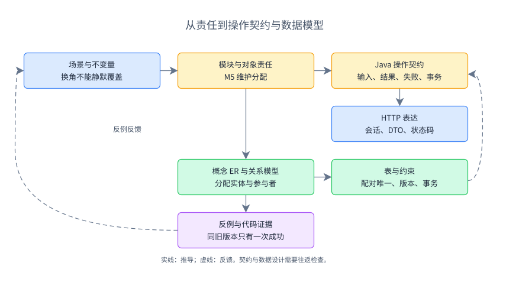

实线箭头表示设计推导，虚线表示约束反馈。例如“不能静默覆盖”促成契约中的旧版本，也促成保存时的版本检查；不能先随意定字段，再寻找业务理由。

接口和数据库可以并行细化。先用一句操作契约描述“管理员将员工在指定系统的角色替换为目标角色，旧版本不符则不保存”，再识别分配记录与唯一性；发现首次授权尚无记录时，返回契约又需要表达“尚未建立分配”。当前用版本 `-1` 表示它。

| 表达 | 回答的问题 | 当前项目例子 |
| --- | --- | --- |
| 概念领域模型 | 业务上有哪些概念，各自承担什么规则 | 员工、部门角色、统一会话 |
| 对象协作图 | 一次操作中谁调用谁，顺序与提交点是什么 | 协调用例先保存停用，再结束会话 |
| 概念 ER 图 | 哪些事实有独立身份，实体间存在什么联系 | 部门与系统存在多对多可用联系 |
| 逻辑表关系图 | 联系如何落表，键、空值和约束是什么 | `system_department` 及组合唯一键 |

DFD 的数据存储是信息集合，不能直接照搬成表；领域概念也不要求一概念一张表。M1 的统一会话就是不落 MySQL 的反例。

### 1.2 三类接口与四种对象

| 接口层次 | 使用者与约束 | 本项目中的位置 |
| --- | --- | --- |
| Java 模块公开能力 | 同一进程内的可信模块；契约仍须说明范围和事务前提 | `OrganizationApi`、`CatalogApi`、`AuthorizationApi` 等 |
| HTTP 业务接口 | 浏览器或外部系统；需要身份、输入形式、响应及失败语义 | `/api/admin/assignments`、`/api/runtime/check` |
| 标准协议端点 | 按 OIDC／OAuth 规则交互的客户端 | `/oauth2/authorize`、`/oauth2/token`、`/connect/logout` |

Java 的 `change(actorId, ...)` 不意味着 HTTP 请求可以提交 `actorId`。管理员来自已验证会话，运行鉴权中的员工来自令牌。框架协议端点也不需要再包装成自定义“登录 API”。

请求 DTO 表达外部输入；模块事实对象表达可信协作需要的信息；JPA 实体表达本模块持久化状态；关系表承载数据库约束。例如 `AssignmentInput` 没有数据库主键，`AuthorizationApi.Assignment` 不暴露 JPA 实体，`AssignmentEntity` 继承版本，而 `role_assignment` 另有员工与系统唯一键。

这些表示可以在简单场景复用，但要检查耦合。当前角色保存直接接收 `CatalogApi.RoleChange`，减少了转换代码，也使 HTTP 与 Java 契约一起变化；若两类使用者需要独立演进，再拆传输 DTO。Java `record` 的不可变外壳也不自动保证内部集合不可变，须像角色返回值那样复制集合。

反过来看，`RoleEntity` 同时映射角色表和权限选择表，`UnifiedPrincipal` 没有 MySQL 表，初始化的 `seed_marker` 也不需要业务实体类。对象数量和表数量不必相等，转换依据是责任、生命周期与持久化约束。

### 1.3 操作契约的最小内容

每个关键操作写清：调用者身份、目标对象、前置条件、输入意图、成功后的状态、失败语义、事务边界。查询还需说明可见范围、分页或规模上限。不要把 Repository 的所有方法直接公开为模块接口。

| 情况 | 当前 HTTP 表达 | 调用方如何处理 |
| --- | --- | --- |
| 有效身份缺少目标权限 | `200`，`allowed=false`，如 `reason=NO_ROLE` | 业务拒绝，不执行操作 |
| 运行令牌或统一会话失效 | 身份用例返回 `401`，如 `IDENTITY_EXPIRED` | 重新登录，不改用请求中的员工编号 |
| 管理越范围或运行系统不匹配 | `403`，如 `OUT_OF_SCOPE` | 停止该操作 |
| 旧版本不符或当前状态不允许 | `409`，`STATE_CONFLICT` | 刷新并重新确认，不能自动覆盖 |
| 审计不可用等技术失败 | `503`，如 `CONTROLLED_SERVICE_PAUSED` | 明确暂不可用，拒绝受控操作 |

以上是业务入口的代表语义。安全过滤器、登录表单和标准协议端点有各自响应；不能承诺全站都是同一种 JSON。`FailureAdvice` 将 `BusinessException` 转为含 `code` 的 ProblemDetail，但其 Bean Validation 分支没有附加该字段，这是当前一致性可改进处。

后台写请求还要先读取 `GET /api/csrf`，用返回的 `headerName` 携带 `token`。本文 JSON 示例只展示业务内容；编号、版本和权限标识为结构示例，运行时须先查询当前数据。

## 2 身份认证与会话

### 2.1 从“登录成功”提炼可信身份契约

M1 负责确定谁在访问、通过哪个系统、属于哪次统一会话。管理员资格由 M2 判断，业务权限由 M5 判断。将三者分开，可以让同一员工复用登录身份，同时在 OA 允许、知识库拒绝。

当前公开签名节选：

```java
SessionIdentity browser(Principal principal);
TokenIdentity token(String token, String expectedSystem);
long directory(String token);
void revokeEmployeeSessions(long employeeId);
boolean logout(Principal principal);
```

`token` 的输入包含请求声称的目标系统，结果中的员工与系统编号则来自核验后的令牌。它同时检查授权类型、令牌有效性、登记系统、统一会话和员工状态；返回值不携带业务权限。`directory` 只接受独立目录身份和 `directory.report` 范围，不能替代员工身份。

HTTP 登录使用表单 `POST /login`，用户名与手机号同时匹配。标准授权码、PKCE、回调、兑换及 OIDC 响应由框架处理；手机号只是本课程 Demo 的简化校验，不是秘密凭据。`GET /api/admin/me` 先取浏览器身份，再核对管理员资格。

### 2.2 哪些状态持久化，哪些没有表

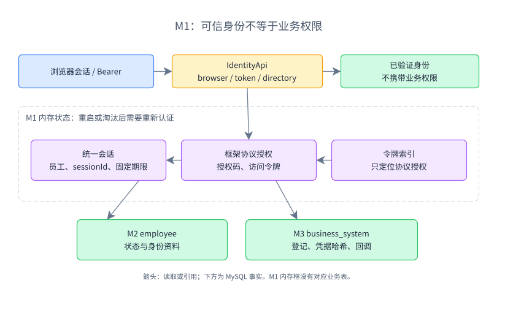

箭头表示事实读取或已验证引用。员工资料归 M2，系统登记归 M3；图内的统一会话、协议授权及令牌索引均为内存状态，虚线框标记重启会丢失的边界，不能把它们加入当前数据库 ER 图。

`UnifiedSessions` 保存会话编号、员工编号与绝对到期时间，最多八小时；`AuthorizationStore` 有界保存框架授权对象和令牌索引，访问令牌的实际期限不超过所属会话剩余寿命。当前浏览器退出只删除对应统一会话；员工停用删除该员工全部统一会话。后续令牌使用仍须核验会话，故令牌索引未立即清空也不代表可以继续使用。

候选是将会话和授权持久化，获得重启连续性及多节点共享能力，但要增加清理、并发兑换、撤销传播与密钥管理。当前单节点实现失去状态后拒绝请求，代价是重启或容量淘汰会要求重新登录。会话容量检查并非数据库式硬唯一约束，不能把其容量阈值当作严格原子计数上限。

### 2.3 到代码和测试中验证

阅读 [IdentityApi](../platform/src/main/java/cn/edu/upms/identity/api/IdentityApi.java)、[IdentityService](../platform/src/main/java/cn/edu/upms/identity/internal/IdentityService.java)、[UnifiedSessions](../platform/src/main/java/cn/edu/upms/identity/internal/UnifiedSessions.java) 与 [AuthorizationStore](../platform/src/main/java/cn/edu/upms/identity/internal/AuthorizationStore.java)。[OidcIntegrationTest](../platform/src/test/java/cn/edu/upms/identity/internal/OidcIntegrationTest.java) 的 `atomicExchange`、`separateCredentials` 和 `independentSessionsAndDisable` 分别检查一次兑换、系统身份隔离和会话失效；它们不证明多节点行为。

## 3 组织与管理范围

### 3.1 资料维护接口不能绕过生命周期

M2 拥有公司、部门、员工及固定管理员身份。普通资料维护与停用、调动具有不同后果，因此分别定义能力：

```java
PageResult<Employee> employees(
    long actorId, String query, Long departmentId, int page, int size);
Employee saveEmployee(long actorId, EmployeeChange change);
void requireEmployeeScope(long actorId, long employeeId);
Employee lockEmployee(long employeeId);
```

`actorId` 是操作者，`employeeId` 是被管理者，不能因二者类型相同而混用。员工查询在服务端拼接部门限制，页大小限制在 1 至 100；`PageResult` 返回 `items`、`total`、`page`、`size`。客户端筛选部门只能缩小允许范围。

`POST /api/admin/employees` 对应资料维护。已有部门员工不能从该入口直接改部门；待确认部门员工可在受控资料维护中完成首次归属。`POST /api/admin/employees/{id}/state` 和 `/transfer` 交给上层 `EmployeeLifecycle`，因为停用需要撤权与会话失效，调动需要先检查原部门撤权。不要在一个通用保存 DTO 中允许调用方随意设置这些状态。

### 3.2 公司、部门、员工怎样建关系

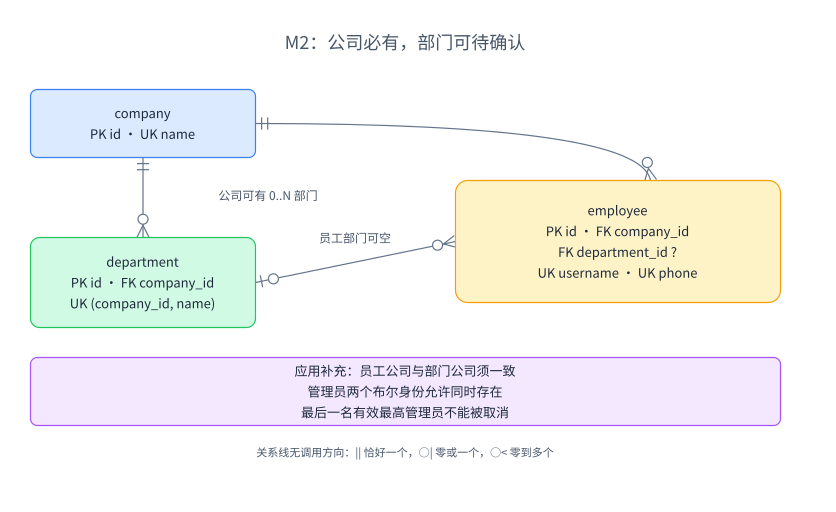

这是乌鸦脚表关系图，实线表示实际外键，没有调用方向。一个部门必须属于一个公司，一个公司可以暂时没有部门；员工必须属于公司，可以没有部门。读取员工与部门之间的关系时，要同时说出“每员工零或一个部门”和“每部门零到多个员工”。

`company.name` 唯一；`department(company_id, name)` 在公司内唯一；`employee.username` 与 `phone` 分别唯一。不能用用户名与手机号的组合唯一替代两个独立唯一要求。

保留 `employee.company_id` 能表示 54 名公司直属、部门待确认员工；员工有部门时，它又与部门的公司归属重叠。当前 `saveEmployee` 检查二者一致，调动同时改两个编号。两个独立外键只能保证公司、部门各自存在，不能保证其相互匹配。

固定管理员身份用 `super_admin`、`department_admin` 两个布尔值表达；它们允许同一人同时具备两种身份，不能推导出“两个字段互斥”。外部业务角色位于 M4/M5，不与这些身份混用。候选是管理员任命关联表，适合将来支持任命期限、多部门范围或独立任命历史；当前固定两类身份用字段更直接，代价是扩展范围时要调整模型。

### 3.3 约束、查询与证据

数据库版本列由 `PersistentRecord.@Version` 管理，客户端提交的旧版本还会由应用显式比较；二者分别防止旧界面覆盖和持久化竞争。至少一名有效最高管理员是跨行规则，当前在共同治理锁内检查数量，不能由一个 `NOT NULL` 或单行唯一键完成。

`ix_employee_department(department_id, active)` 服务于部门筛选及有效员工统计。用户名匹配可利用独立唯一索引；姓名、用户名、手机号的 `%关键字%` 联合搜索不应被描述成一定命中这些索引。进一步优化须观察实际查询计划。

定位 [OrganizationApi](../platform/src/main/java/cn/edu/upms/organization/api/OrganizationApi.java)、[OrganizationService](../platform/src/main/java/cn/edu/upms/organization/internal/OrganizationService.java) 与 [EmployeeRepository](../platform/src/main/java/cn/edu/upms/organization/internal/EmployeeRepository.java)。[FoundationIntegrationTest](../platform/src/test/java/cn/edu/upms/application/FoundationIntegrationTest.java) 的 `administratorScope`、`invariants` 检查范围和管理员不变量；并发调动另见第 9 节。

## 4 系统接入

### 4.1 系统身份、可用范围与权限分配分开

M3 回答“这是哪个系统”“哪些部门可以使用它”，不回答员工已有哪个角色。一个部门获准使用 OA 后，仍须由 M5 为员工分配角色。

```java
SystemFact bind(long actorId, long systemId, Set<Long> departments, long version);
boolean available(long systemId, Long departmentId);
Credentials rotateCredentials(long actorId, long systemId, long version);
```

`POST /api/admin/systems/{id}/departments` 接收 `{"departments":[1,2],"version":4}`，表达完整替换目标集合。服务检查最高管理员、旧版本和部门有效性；被移除关联改为停用，后续鉴权不再认可。候选是逐项增删端点，适合独立编辑大量关联，但要额外定义每项冲突和部分成功；当前小规模配置选择整集合确认。

`POST /api/admin/systems/{id}/credentials` 接收确认版本，仅在响应中展示新凭据，并设置 `Cache-Control: no-store`。存储字段虽然名为 `client_secret`、`directory_secret`，内容是编码器产生的哈希。普通系统列表返回 `SystemView`，不返回这两个字段。

### 4.2 多对多怎样变成关联表

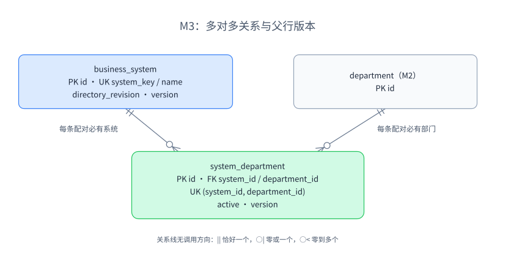

图中两条一对多实线构成概念上的多对多：部门与系统之间通过 `system_department` 建立联系。每条关联必须引用一个系统和一个部门，父表可以没有关联。

关联表有独立 `id`、`active`、`version`，以及 `UNIQUE(system_id, department_id)`。组合唯一防止同一配对重复；独立主键便于沿用 JPA 持久化基类；`active` 表示当前有效性。候选是组合主键且删除关联即取消范围，表更简洁，但当前选择保留配对行。保留行只保留最后状态，完整变更历史仍由审计记录。

`business_system` 中有三个容易混淆的量：`directory_revision` 是外部目录顺序；JPA `version` 检测行变化；内部 `management_revision` 在配置或范围变化时递增，使系统父行发生变化。它不是对外另一个管理版本，不能要求客户端额外提交它。绑定会变化父行，因此只修改关联集合也能使旧系统版本失效。

### 4.3 取舍与证据

认证适配器确实需要凭据哈希，但当前 `SystemFact` 同时承载普通系统事实和哈希，内部可见范围较宽。合理改进是拆分客户端认证事实与普通系统事实；不能因为哈希不是明文就认为无需收窄暴露范围。本轮保留现状。

定位 [IntegrationApi](../platform/src/main/java/cn/edu/upms/integration/api/IntegrationApi.java)、[IntegrationService](../platform/src/main/java/cn/edu/upms/integration/internal/IntegrationService.java) 和 [AdminController](../platform/src/main/java/cn/edu/upms/application/AdminController.java) 的 `systems`、`credentials`。`FoundationIntegrationTest.systemScope` 验证多对多与旧版本冲突；`OidcIntegrationTest.separateCredentials` 验证两类系统身份隔离。

## 5 权限目录与角色

### 5.1 从“系统提供权限”推导两组操作

目录接收来自系统，角色配置来自管理员，不能共用调用者身份。

```java
boolean report(long systemId, long revision, List<DirectoryItem> items);
Role save(long actorId, RoleChange change);
Role copy(long actorId, long templateId, long departmentId, String name);
```

`POST /api/directory/report` 用独立目录令牌确定 `systemId`，报文不自行指定归属。以下仅是一个权限项系统的完整报文示例；已有系统须携带全部有效历史项，不能把单项示例直接当增量更新：

```json
{
  "revision": 2,
  "items": [
    {"key":"document.read","module":"文档","feature":"正文","action":"查看","active":false}
  ]
}
```

初次新版本接收返回 `{"accepted":true,"changed":true,"revision":2}`；相同版本、相同内容重报返回 `changed=false`；同版本不同内容或旧版本拒绝。有效历史项遗漏是错误；停用必须明确上报 `active=false`。以前已经停用的历史项可以省略。目录数据、版本推进、角色选择调整及成功审计共同提交，失败保留旧目录。

`POST /api/admin/roles` 使用 `RoleChange`，其中 `permissions` 是权限编号集合，表达完整替换。目录 key 是外部系统稳定标识，数据库权限 id 是平台引用，两者用途不同。角色保存不允许变更既有系统、部门和模板属性；复制模板则创建独立部门角色。

### 5.2 角色、模板和权限的关系

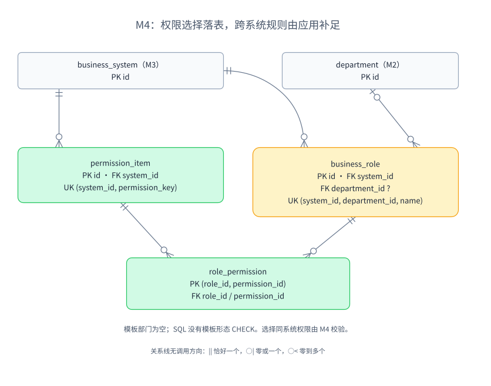

实线是实际外键。`role_permission` 每行表达一个角色选择一个权限，复合主键防止重复选择；角色和权限分别引用系统。但这些外键不能阻止“OA 角色选择知识库权限”，同系统规则仍由 `CatalogService.save` 校验。

模板和部门角色共享 `business_role`：模板 `template=true` 且 `department_id=NULL`，部门角色相反。当前由应用验证这一组合，SQL 没有对应 `CHECK`。候选是模板与部门角色分表，可让部分形态更严格，但会增加共有行为与复制查询的处理；当前结构复用相同权限集合，代价是必须维护形态规则。

角色名称的唯一键为 `(system_id, department_id, name)`。MySQL 允许唯一索引中出现多个含 `NULL` 的组合，因此它不能独自防止全局模板同名。当前在治理锁内补查同范围名称，逻辑删除角色也保留名称。未来可通过调整范围键或增加数据库表达约束强化，但不能把尚未建立的约束画进当前图。

目录明确停用时，当前代码将权限从角色选择集合撤下，恢复目录不会恢复旧选择；新增项也不自动加入。模板复制保存的是权限集合副本，没有 `template_id` 继承关系，也不会随模板后续修改传播。

### 5.3 集合映射、版本与验证

`RoleEntity.permissions` 使用 `@ElementCollection Set<Long>`，由 `role_permission` 存储编号。数据库有两个外键，但 Java 没有建立跨模块或跨实体的可遍历对象网。不要从标量编号推断“没有外键”，也不要从外键推断“必须写 `@ManyToMany`”。

V2 增加的 `content_revision` 是内部内容变动标记，保存、删除或撤下权限时推进父行变化；对外冲突检测仍使用 `Role.version`。它与目录报文的 revision 不同。V4 的 `deleted` 区分逻辑删除和可重新启用的停用；删除前由上层在共同治理锁内检查没有未撤销分配。直接调用 `CatalogApi.delete` 的可信调用者必须遵守这个前提。

定位 [CatalogApi](../platform/src/main/java/cn/edu/upms/catalog/api/CatalogApi.java)、[CatalogService](../platform/src/main/java/cn/edu/upms/catalog/internal/CatalogService.java)、[RoleEntity](../platform/src/main/java/cn/edu/upms/catalog/internal/RoleEntity.java) 与 [DirectoryController](../platform/src/main/java/cn/edu/upms/application/DirectoryController.java)。`FoundationIntegrationTest.isolatedCopy`、`directoryValidation` 检查复制隔离、停用、重报和恢复不自动授权；`OidcIntegrationTest.roleDeletion` 检查删除前撤权。

## 6 授权与鉴权

### 6.1 写入命令和运行查询需要不同契约

M5 维护角色分配，并用当前事实计算权限。管理员有修改权，业务系统只有请求判断的资格。

```java
Assignment change(
    long actorId, long employeeId, long systemId, Long roleId, long expectedVersion);
Decision decide(long employeeId, long systemId, String permissionKey);
```

`POST /api/admin/assignments` 的实际请求形态：

```json
{"employeeId":22,"systemId":1,"roleId":35,"expectedVersion":4}
```

成功返回含 `employeeId`、`systemId`、`roleId`、`revoked`、`version`、`changedAt` 的分配事实。角色编号置 `null` 表示撤销；首次没有分配行时旧版本为 `-1`，已有撤销行仍应使用其当前版本。接口将首次分配、换角、撤销合为一种状态替换，减少分支入口；代价是 `null` 和 `-1` 必须明确说明。分开命令或资源式 `PUT/DELETE` 都是合理候选，本轮不将其写成现有端点。

运行接口 `POST /api/runtime/check` 使用 Bearer，业务体仅为：

```json
{"system":"oa","permission":"document.read"}
```

`RuntimeController` 先调用 M1 获得可信员工与系统，再调用 `decide`。有效身份但没有角色可得到 `{"allowed":false,"reason":"NO_ROLE"}`；有效角色缺少动作则为 `PERMISSION_MISSING`。鉴权超时或异常不等于允许；模拟系统收到失败不得执行受控操作。

### 6.2 单角色为何需要一条可保留的分配记录

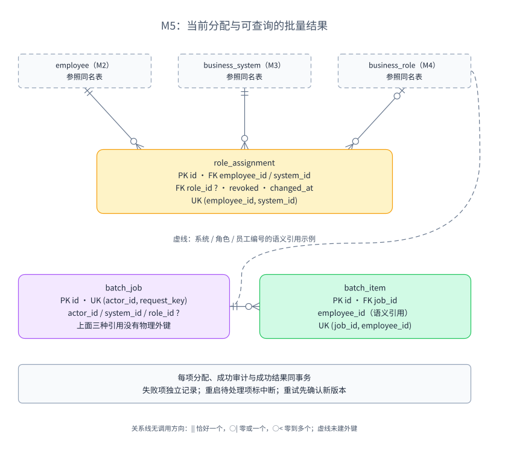

实线表示物理外键，虚线只表示未建外键的业务编号引用。每条分配必有员工和系统，角色可以为空；一名员工与一个系统的配对最多一条分配。批量任务与明细另存，任务并不拥有角色的副本。

以下为当前迁移中的关键约束节选：

```sql
UNIQUE KEY uk_employee_system(employee_id, system_id)
PRIMARY KEY (role_id, permission_id)
UNIQUE KEY uk_batch_request(actor_id, request_key)
```

三条分别属于 `role_assignment`、`role_permission`、`batch_job`，不能拼成一张表的建表语句。

分配行保留 `role_id=NULL`、`revoked=true`、`changed_at` 与递增版本，便于撤权后检测旧请求、判断调动等待窗口。它不是完整授权历史；历史由审计保存。若撤权直接删除行，后续首次状态可能再次表现为 `-1`，需要另一种版本或历史机制防止旧请求被误认为首次分配。

`system_id` 不能简单从角色推导：撤销后角色为空，仍需知道撤销的是哪个系统；它还承担配对唯一性。有效角色的系统、部门必须与员工和目标系统匹配，这些规则由事务内应用校验保证。SQL 未声明 `revoked` 与 `role_id` 的组合 `CHECK`，也没有用复合外键保证同系统角色。

### 6.3 为什么有唯一键，还要版本和锁

| 机制 | 防止什么 | 单独使用仍缺什么 |
| --- | --- | --- |
| 员工与系统唯一键 | 同配对插入两行分配 | 同一行仍可能被旧界面覆盖 |
| `expectedVersion` 显式比较 | 操作者依据旧状态修改 | 比较后到保存前仍有竞争 |
| JPA `@Version` | 保存时覆盖已变化行 | 不能独自核验跨表状态与范围 |
| 共同锁顺序与事务 | 组织、系统、角色与分配变化交错 | 不替代输入校验、唯一键和冲突提示 |

当前管理写入先取固定总公司行的治理锁，再按员工、系统、角色顺序锁定；成功分配与审计同事务。粗锁降低证明竞态的难度，也限制管理写入吞吐，不能称为普遍最优。单纯增加更多锁，也不会自动修正错误的锁顺序。

读取使用模块公开能力装配事实，纯 `EffectivePermissionRule` 计算有效权限；默认不启用权限缓存。`READ_COMMITTED` 不是整个多次查询的固定时间点快照，不能因变量名含“快照”就宣称读到了全局原子视图。当前通过状态复核、变更后生效上限及竞争测试验证约定；若要求严格线性一致的判断，须重新设计读取边界并评估成本。

### 6.4 批量为什么需要两张表

`POST /api/admin/batches` 接收 `requestKey`、`systemId`、可为空的 `roleId` 及 `targets`；每个 target 为 `employeeId`、`expectedVersion`。任务限定 1 至 100 个不同员工，先整批范围预检，再逐项提交，响应 `Job` 带逐项结果。当前请求内执行，不应描写为已接入异步任务队列。

`batch_job` 保存共同意图与状态，`batch_item` 保存每名员工的确认版本及执行结果，避免把可变长度员工清单塞进一个字符串。`UNIQUE(job_id, employee_id)` 防重复明细，`UNIQUE(actor_id, request_key)` 防同一操作者重复建任务；同 key 不同内容拒绝。应用的单节点分段锁避免同 key 并发都执行。

每项分配、成功审计和成功结果共同提交；某项失败不撤销其他成功项。重启后待处理项标为中断；`POST /api/admin/batches/{id}/retry` 接收重新确认版本的目标列表，只重试失败或中断项。部分编号没有物理外键，完整性依赖应用；`revoke_roles` 与 `role_id` 的空值含义有冗余，也需要共同维护。

当前实现的幂等比较还有边界：重试会覆盖明细 `expected_version`，提交入口又用当前明细比较原请求内容。重试之后原样重放最初的提交可能收到冲突，不能承诺永久重放兼容。若要增强该契约，可独立保存不可变原始请求或摘要，再将重试确认单独记录；这是候选改进，尚未实现。

`ix_assignment_role(role_id, revoked)` 用于角色影响和删除前查询。配对唯一索引的员工前缀还支持按员工查全部分配。索引是否足够仍要看实际 SQL 与数据分布，不能把单次测试通过当作任意规模结论。

代码见 [AuthorizationService](../platform/src/main/java/cn/edu/upms/authorization/internal/AuthorizationService.java)、[EffectivePermissionRule](../platform/src/main/java/cn/edu/upms/authorization/internal/EffectivePermissionRule.java)、[BatchService](../platform/src/main/java/cn/edu/upms/authorization/internal/BatchService.java) 及 [RuntimeController](../platform/src/main/java/cn/edu/upms/application/RuntimeController.java)。[AssignmentConcurrencyTest](../platform/src/test/java/cn/edu/upms/authorization/AssignmentConcurrencyTest.java) 验证同版本换角、停用／调动竞争和批量幂等；`OidcIntegrationTest.batchResults` 验证整批越范围拒绝、部分成功及明确重试。

## 7 审计与统计

### 7.1 记录能力参与业务事务

M6 接收调用方已核验的事件事实；它不反向读取组织或角色实体来猜测事件当时的归属。

```java
void record(Event event);
void requireAvailable();
PageResult<View> query(
    Long departmentId, String eventType, String result, String query,
    Instant from, Instant to, int page, int size);
```

`record` 的成功意味着审计写入参加调用方事务，不意味着它已独立提交。`saveAndFlush` 使写错误尽早暴露，但 flush 仍不是 commit。成功管理变更与审计一起提交；审计故障回滚变更并暂停新的受控操作。退出先使会话失效，记账失败也不会恢复会话，这是接口契约需要明确的例外。

`GET /api/admin/audit` 的管理范围由入口强制计算，再调用 `query`。这里 `departmentId=null` 表示全局查询，因此模块契约要求只有经过核验的调用者才能传它。当前不是一种独立的“范围授权类型”；若调用者增多，可用显式范围值对象减少误传。

### 7.2 历史引用为何不能画成当前归属

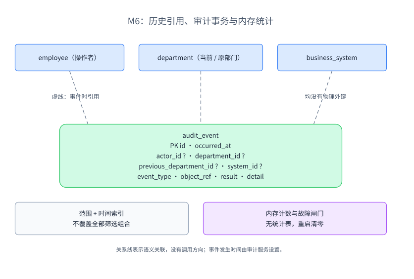

虚线表示业务语义引用，均不是 SQL 外键。`department_id` 与 `previous_department_id` 是事件携带的归属事实；员工后来调动不能把历史事件的部门改掉。图中另一侧的允许／拒绝计数属于内存统计，没有对应统计表。

`audit_event` 有主键、发生时间、可空操作者与范围编号、类型、对象引用、结果及详情；当前没有声明业务编号外键。这样可以独立保留事件，但数据库不能防止错误编号，完整性依赖事件生产者。它也没有保存完整的人员／系统名称快照，不能承诺名字变化后仍可还原全部原始显示内容。

`ix_audit_scope(department_id, occurred_at)` 和 `ix_audit_time(occurred_at)` 是当前显式索引。查询还会按 `previous_department_id` 匹配调动前部门，并按 `id` 倒序分页；现有两个索引并不覆盖所有组合，跨两列的 OR 及 `%对象%` 搜索需要实际 `EXPLAIN` 再考虑补索引。

### 7.3 同步审计的代价

关键事件同步写库使事务一致性容易观察，但增加写延迟，当前每秒探测也写入 `AUDIT_HEALTH`，长期会积累事件。允许鉴权只做内存计数，拒绝记录必须保存；这些计数重启清零，`elapsedNanos` 是累计耗时，不能直接当 P95 或历史完整吞吐率。将健康探测隔离存储、调整保留策略或建立监控是候选，本期不新增。

故障恢复事件明确报告审计缺口、完整性未知，不承诺补录。异步事件队列若要替代同步保存，必须重新解决业务提交后事件丢失的问题；当前不能仅为了“解耦”把同事务审计改成易丢失的内存通知。

定位 [AuditApi](../platform/src/main/java/cn/edu/upms/audit/api/AuditApi.java)、[AuditService](../platform/src/main/java/cn/edu/upms/audit/internal/AuditService.java) 和 [AuditEvent](../platform/src/main/java/cn/edu/upms/audit/internal/AuditEvent.java)。`OidcIntegrationTest.auditStorageFailure` 在专用测试库制造审计表故障，断言回滚、暂停、退出不恢复和恢复事件；它不证明故障期间完整补录。

## 8 从概念 ER 到当前数据库

### 8.1 先画事实与联系，再转换

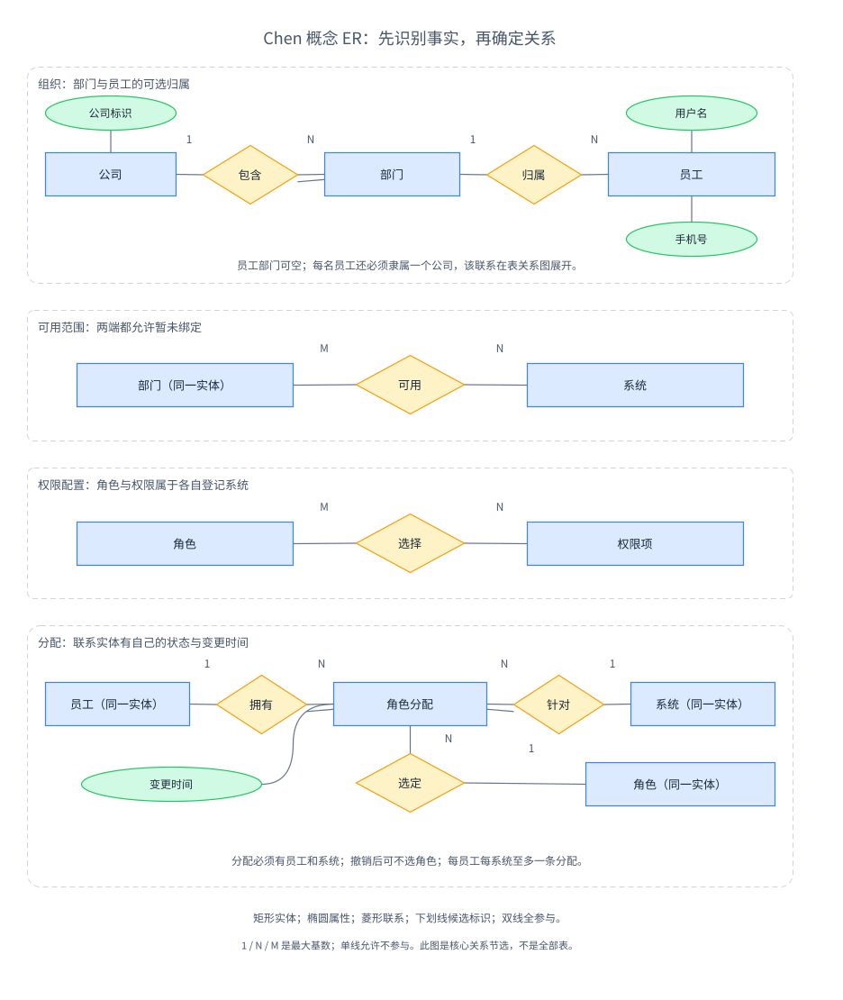

矩形是实体，椭圆是属性，菱形是联系；带下划线属性是候选标识，双线表示全参与，边上的 `1`、`N`、`M` 表示最大基数。单线只表示允许不参与，具体最小值仍结合业务说明读取。本图以分块排列覆盖组织、部门可用系统、角色选权限与员工分配，重复出现的实体是同一概念的引用。

在 draw.io 中可按以下顺序重画这个模型：

1. 从场景中找需长期辨认的事实：员工、部门、系统、角色、权限；“检查”“登录”这类动作先作为操作，不立即建实体。
2. 为实体写稳定标识，再写与本次推导有关的属性；不要把所有 Java 字段都塞进概念图。
3. 对每条联系从两端分别提问“一个可以关联几个”“是否允许零个”。部门可用系统两端都是零到多个；员工归属部门则可空。
4. 联系有自身状态或身份时，判断是否需要实体化。员工角色分配需保存版本、撤销及变更时间，适合成为独立事实。
5. 转换成关系表：一对多通常在多端保存外键，多对多建立关联表，独立联系实体再保存其参与者编号。
6. 用撤销、无部门、重复提交和并发换角等反例检查模型，再补物理约束。图能画出联系，不等于 SQL 已实现全部业务规则。

员工、系统、角色不能只用一条任意多对多连线表达分配规则。当前选择分配实体后，再以 `(employee_id, system_id)` 唯一约束表达“每系统最多一个当前角色”；角色可空以保存撤销状态。这是从业务联系走向生命周期模型的一次设计选择。

### 8.2 全库逻辑关系与物理约束

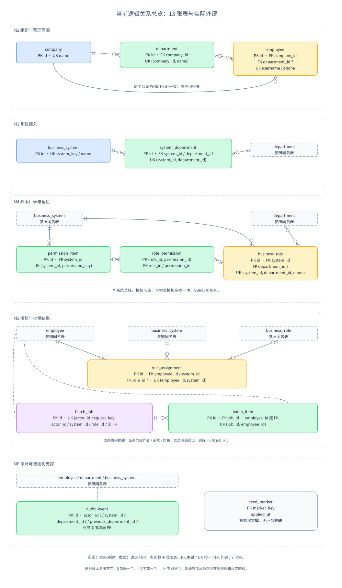

图按模块分区，`PK` 表示主键，`FK` 表示实际外键，`UK` 表示独立或组合唯一约束；`?` 表示可空。实线带乌鸦脚表示物理关系，虚线是未建外键的语义引用，不能当作数据库承诺。图内为了阅读重复使用了部门／系统／员工参照框，它们不增加表数量。普通版本、名称等字段省略，详图和迁移负责解释。

| 模块／用途 | 当前关系表 | 关系和关键约束 |
| --- | --- | --- |
| M2 | `company`、`department`、`employee` | 公司必选、员工部门可空；身份各自唯一；部门名公司内唯一 |
| M3 | `business_system`、`system_department` | 系统标识和名称分别唯一；系统部门配对唯一 |
| M4 | `permission_item`、`business_role`、`role_permission` | 权限 key 系统内唯一；角色名按范围约束；选择对为复合主键 |
| M5 | `role_assignment`、`batch_job`、`batch_item` | 分配配对、批量请求标识、任务员工明细分别唯一 |
| M6 | `audit_event` | 历史引用没有业务外键；按范围与时间建索引 |
| 初始化支撑 | `seed_marker` | `marker_key` 主键，记录基础数据已应用；不属于权限领域实体 |

图中物理外键来自 [V1](../platform/src/main/resources/db/migration/V1__business_schema.sql)；完整当前结构还包含 [V2](../platform/src/main/resources/db/migration/V2__role_revision.sql) 的角色内容标记、[V3](../platform/src/main/resources/db/migration/V3__batch_idempotency.sql) 的批量请求键及其唯一约束、[V4](../platform/src/main/resources/db/migration/V4__role_removal.sql) 的逻辑删除。不能只读 V1 就声称图反映当前数据库。Flyway 演进结构，JPA `validate` 核对映射；校验映射也不等于验证全部外键、索引和业务不变量。

### 8.3 用范式发现具体异常

第一范式关注属性值的原子性：把权限 id 列表存成逗号字符串，会使唯一选择、外键和单权限查询变得困难，因此角色选择单独成表。权限名称中的文字分隔符并不自动违反第一范式，判断应依据它是否被当作多个独立值操作。

第二范式关注复合候选键的部分依赖。若在 `role_permission(role_id, permission_id)` 中重复保存角色名，角色名只依赖 `role_id`，每个选择都要重复更新；当前角色名留在 `business_role`。增加一个自增 id 并不能自动消除候选键上的依赖问题。

第三范式提醒检查非键事实之间的传递依赖。有部门员工的公司可经部门推得，但当前员工公司仍保存，以表示无部门员工。这里存在有条件的冗余，须由保存和调动一起维护；不能无条件宣称所有表都严格满足第三范式。替代方案是将直属公司归属与部门归属分开表达，减少部分冗余，但查询、空值及约束会更复杂。

审计的事件时部门与员工的当前部门属于不同时间语义，不能因为都叫部门就删除“冗余”字段。范式分析先写清事实的含义和函数依赖，再决定是否分表。

### 8.4 从查询与故障反推物理选择

主键用于稳定引用，唯一键守住业务身份，外键守住引用存在；索引服务实际查询，事务维护一组状态共同成立。`NOT NULL`、列长度和时间精度也应有语义：部门可空表达待确认，`TIMESTAMP(6)` 支撑变更时间记录；时间精度本身不会保证三秒生效。

业务约束落点应逐条记录。例如“角色属于该系统”由外键保证角色存在、由应用保证同系统；“模板名唯一”由含空值唯一键配合治理锁内检查。直接改 SQL 绕过应用可能破坏这些规则，这是当前实现边界。可改进方案包括补充 `CHECK`、调整唯一范围表达或增加受控复合引用，但须另立迁移、检查已有数据并补测试，本轮不执行。

## 9 用两个场景检查设计闭合

### 9.1 换角：输入旧版本为何影响到事务

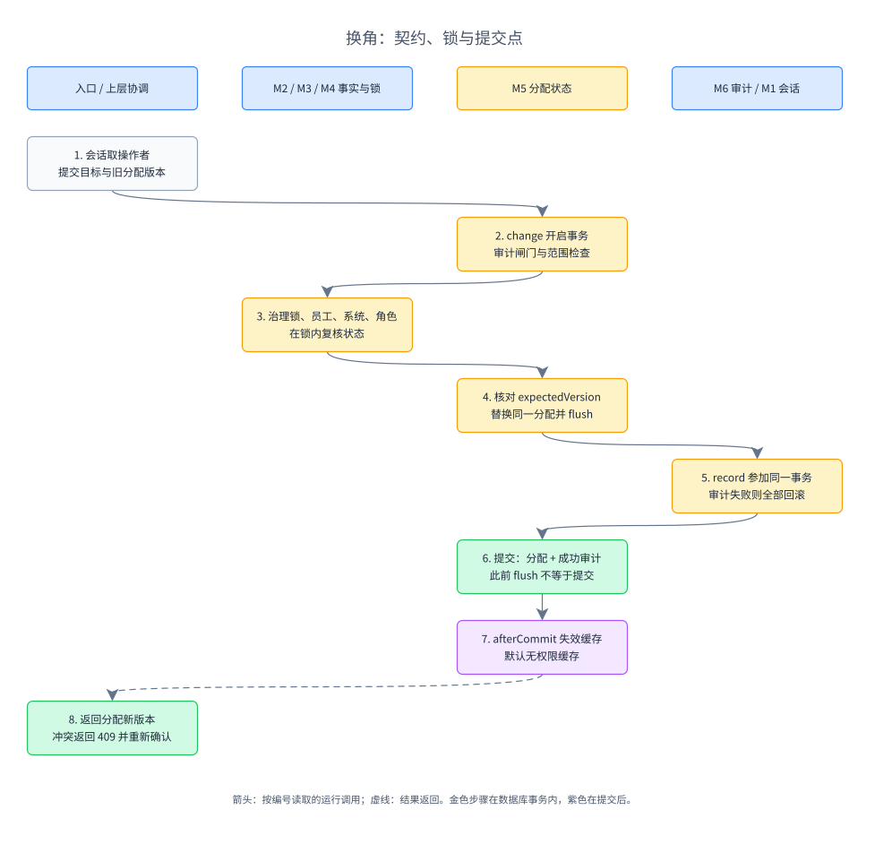

按编号读取运行先后，跨列表示责任之间的调用或返回，虚线表示最终结果；金色步骤在数据库事务内，紫色步骤在提交后。图不是完整 UML 时序图。前端提交旧版本，Controller 从会话取操作者，M5 在锁内再次核对范围和状态，更新唯一分配并写审计。成功提交后才主动失效权限缓存；默认缓存关闭。

甲乙都读到分配版本 4。甲换为 B 并提交版本 5；乙轮到执行后读到 5，与提交的 4 不符，返回 409，角色仍为 B。若只保留唯一键，乙完全可能把同一行改为 C，数量仍为一，却静默覆盖甲。接口中的确认语义因此需要数据库和事务协作。

审计失败时分配回滚，提交后动作不执行；响应失败不能被页面当成授权已生效。批量只是将同一用例放进每项独立事务，不能把成功项在后续项目失败时全部回滚。

### 9.2 停用：数据库事务到哪里结束

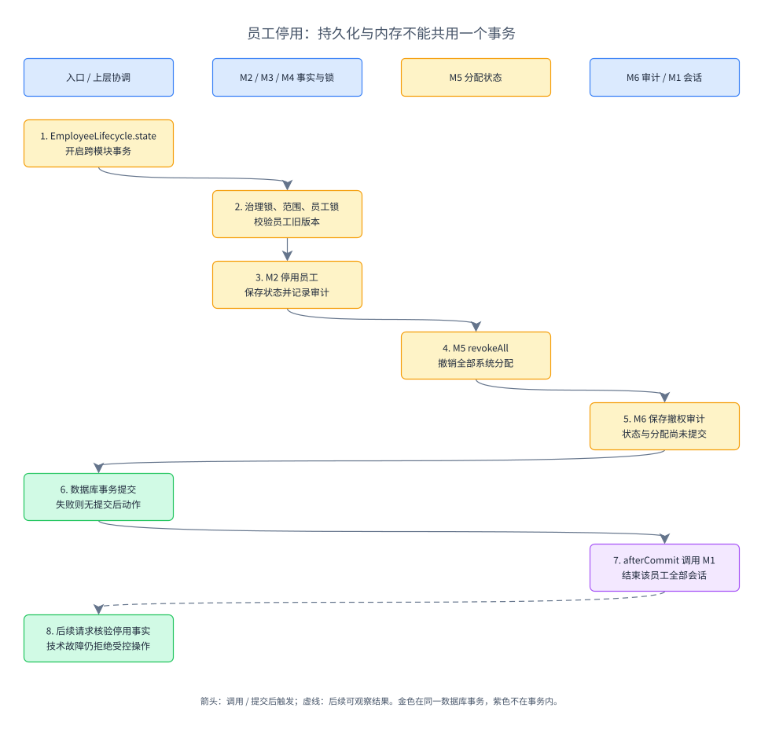

箭头按编号表示运行先后与提交后触发，列表示责任归属。`EmployeeLifecycle.state` 在一个事务内协调 M2 员工停用、M5 全系统撤权与 M6 审计；M1 的内存会话失效位于 `afterCommit`。它没有直接读取或修改其他模块的实体。

如果提交前失败，员工状态与分配共同回滚，不能先删除内存会话再称为“事务全部回滚”。如果数据库已经提交而会话失效动作失败，员工已停用这个持久事实仍会使后续 M1 核验拒绝；不能将数据库提交回滚成有效员工。权限缓存也不能替代员工／统一会话核验。

调动复用相同治理锁及员工锁，但流程不同：原部门手工撤销所有角色并等待三秒，最高管理员调整部门及公司、清除部门管理员身份，新部门再授权。不能把停用的全系统撤权协调直接描述为自动调动继承。

实现见 [EmployeeLifecycle](../platform/src/main/java/cn/edu/upms/application/EmployeeLifecycle.java)。`AssignmentConcurrencyTest.simultaneousAssignments`、`disableAndAssign`、`transferAndAssign` 检查冲突结果；`OidcIntegrationTest.manualTransfer`、`auditStorageFailure` 检查人工前提与故障边界。有限次数并发测试能发现具体竞态，不能替代所有交错顺序的理论证明。

## 10 代码证据、改进与练习

### 10.1 从规则查到契约、约束与测试

以下路径相对 `platform/src/main/java/cn/edu/upms/`；测试均位于 `platform/src/test/java/cn/edu/upms/`。规则编号对应需求规格，完整需求与 DFD 映射继续由分析与设计指南维护。

| 业务规则 | 操作契约 | 数据约束／状态 | 代码入口 | 现有验证场景 |
| --- | --- | --- | --- | --- |
| AUTH-001 至 004：身份与会话独立于权限 | `IdentityApi.token` | 内存会话、令牌与持久员工状态 | `identity/internal/IdentityService.java` | `OidcIntegrationTest.independentSessionsAndDisable`、`separateCredentials` |
| EMP-001、ADM-001：管理范围由服务端检查 | `requireEmployeeScope` | 员工部门与固定身份；应用校验 | `organization/internal/OrganizationService.java` | `FoundationIntegrationTest.administratorScope`、`invariants` |
| SYS-001：部门系统多对多 | `IntegrationApi.bind` | `uk_system_department`，父行版本 | `integration/internal/IntegrationService.java` | `FoundationIntegrationTest.systemScope` |
| ROLE-001、002：复制后独立、同系统选择 | `CatalogApi.copy/save` | 角色与选择集合；系统匹配由应用保证 | `catalog/internal/CatalogService.java` | `FoundationIntegrationTest.isolatedCopy` |
| PERM-001：目录停用、等价重报 | `CatalogApi.report` | 权限唯一、目录版本、原子撤下选择 | `application/DirectoryController.java` | `FoundationIntegrationTest.directoryValidation` |
| GRANT-001：单角色与旧状态冲突 | `AuthorizationApi.change` | `uk_employee_system`、版本、共同锁 | `authorization/internal/AuthorizationService.java` | `AssignmentConcurrencyTest.simultaneousAssignments` |
| GRANT-002：整批范围、逐项结果 | `BatchApi.submit/retry` | `uk_batch_request`、`uk_batch_item` | `authorization/internal/BatchService.java` | `OidcIntegrationTest.batchResults` |
| AUTHZ-001：逐次判断有效权限 | `AuthorizationApi.decide` | 只读事实、纯规则；缓存默认关闭 | `application/RuntimeController.java` | `EffectivePermissionRuleTest`、`OidcIntegrationTest.separateCredentials` |
| EMP-001、002：停用与人工调动 | `EmployeeLifecycle.state/transfer` | 员工、分配、审计共同事务 | `application/EmployeeLifecycle.java` | `AssignmentConcurrencyTest.disableAndAssign`、`transferAndAssign` |
| AUDIT-001：成功管理变更可靠留痕 | `AuditApi.record` | 同事务审计；内存故障闸门 | `audit/internal/AuditService.java` | `OidcIntegrationTest.auditStorageFailure` |

源码依赖由 [ModuleBoundaryTest](../platform/src/test/java/cn/edu/upms/ModuleBoundaryTest.java) 检查：跨模块只使用公开能力、业务模块无循环、Controller 不直接存取内部实体和 Repository。数据库跨模块外键不属于 Java 源码依赖，不能据此误判为违规。

既有运行结果见[最终验收报告](最终验收报告.md)及其原始记录。本文核对测试代码与已有证据，本轮不重新运行正式负载，也不把图文校验称为新一轮功能验收。当前未实现的多节点、持久会话和可靠审计补录继续属于扩展。

### 10.2 值得保留的改进问题

| 当前取舍 | 何时重新考虑 | 要付出的工作 |
| --- | --- | --- |
| Java 事实类型含认证哈希；少量 HTTP 直接复用模块类型 | 使用者增多或需要独立演进 | 收窄认证事实，增加必要 DTO 和兼容测试 |
| 某些跨表规则由共同锁内应用检查 | 出现其他写入程序或迁移需强化约束 | 清理旧数据，新增数据库约束与竞争测试 |
| 治理锁较粗，部分角色／任务查询在内存筛选 | 测量发现写入或数据增长瓶颈 | 先定位查询与锁竞争，再证明更细边界 |
| 批量明细兼作当前重试版本和原始请求比较依据 | 需要重试后仍原样重放初次请求 | 保存不可变提交事实，另记重试确认并补契约测试 |
| 审计索引未覆盖全部筛选，健康事件持续入库 | 查询计划或存储增长显示问题 | 测量后调整索引、探测与保留策略 |
| `AuditApi.query(null, ...)`、锁能力有隐含可信前提 | 调用链增加或频繁误用 | 用显式范围类型／更窄能力表达前提 |

### 10.3 三个练习及参考判断

1. 若老师要求每员工每系统可同时有多个角色，哪些地方先变？先改业务规则和冲突语义，再评估 `change`、分配唯一键、有效权限合并、批量输入及界面；不能只删唯一键。还要定义多角色撤销与重复授予。
2. 若权限选择改存 JSON，是否更面向对象？对象表示与关系约束是两件事；当前关联表可使用主外键约束选择。JSON 候选要额外承担引用检查、单项更新及查询成本，不能只比较表数。
3. 若要让节点重启后仍保持登录，是否补一张 session 表就够？还需协议授权、令牌索引、签名密钥、绝对期限、一次兑换及退出传播的一致方案；先列状态与故障语义，再决定存储。

交流时可以任选一个模块，按“业务事实、公开操作、输入来源、关系与约束、失败结果、代码证据”的顺序说明，再用一个反例检验。能解释错误如何被阻止，比背出端点数量和表名更能检验是否理解设计。
